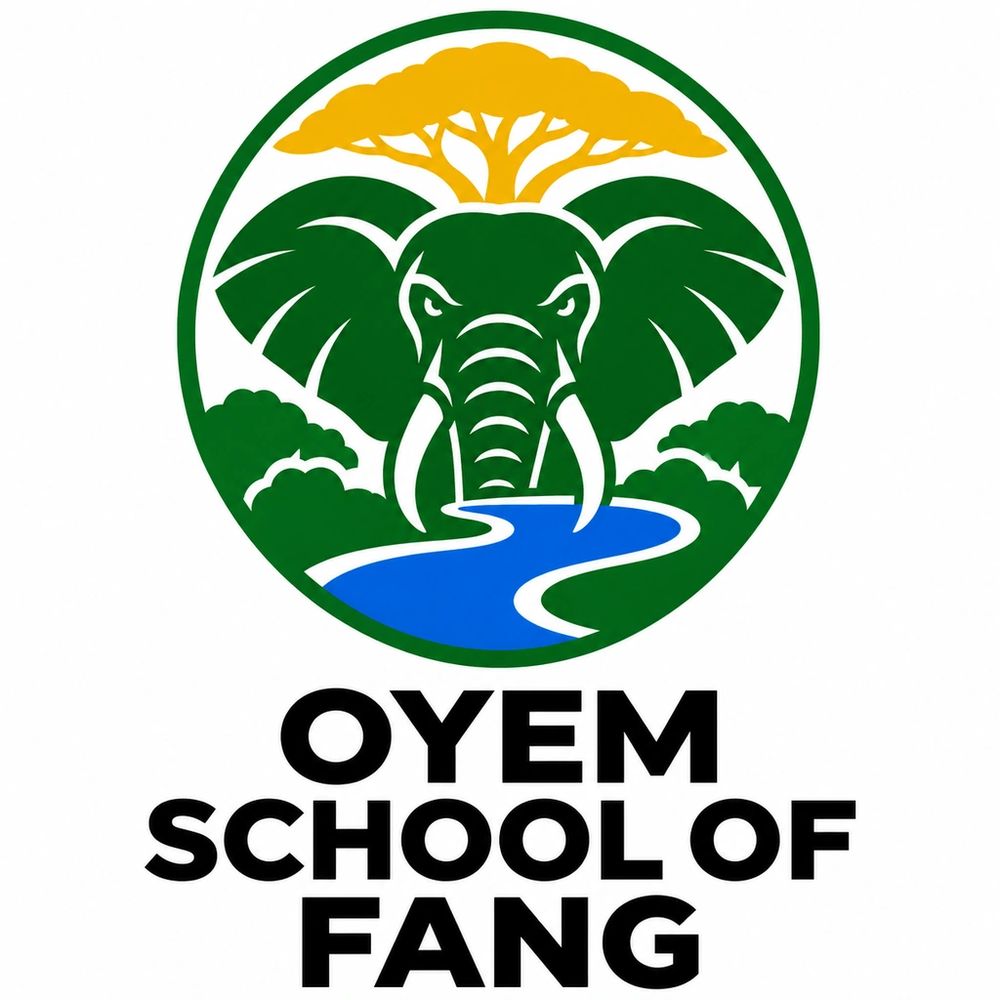
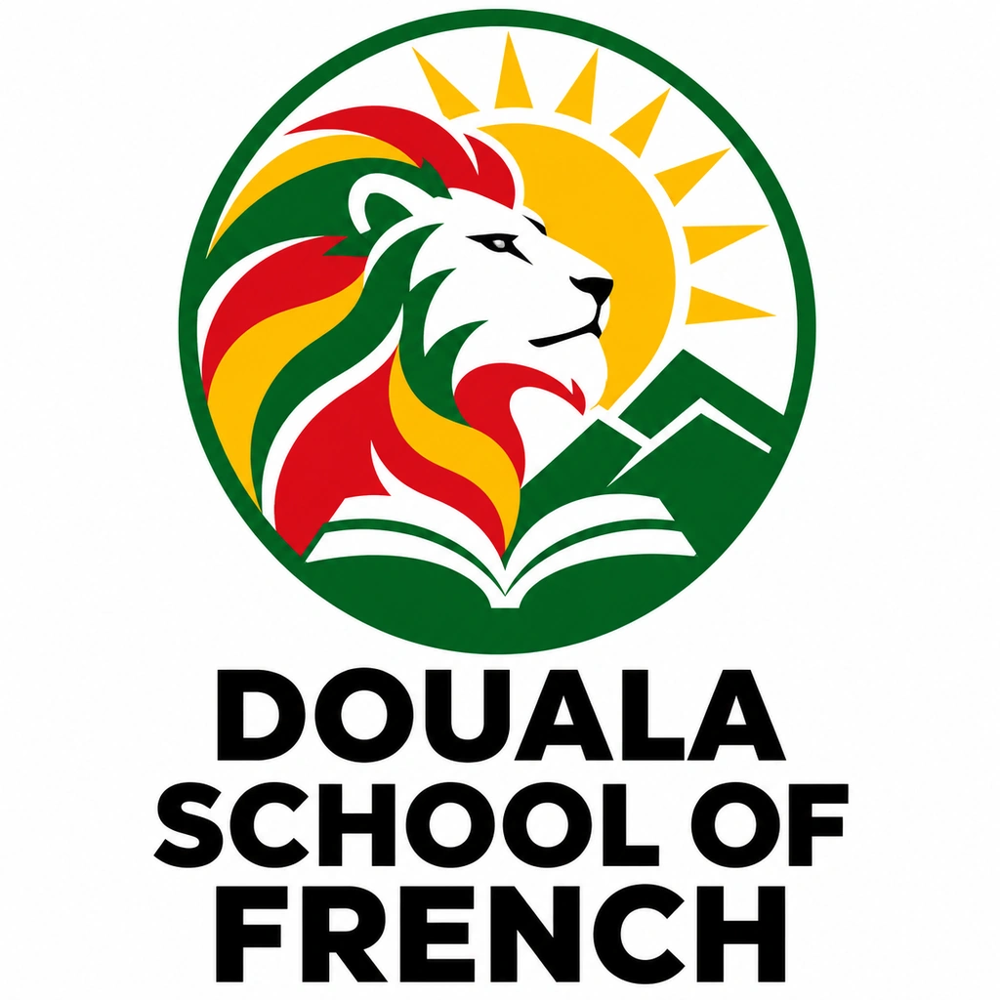
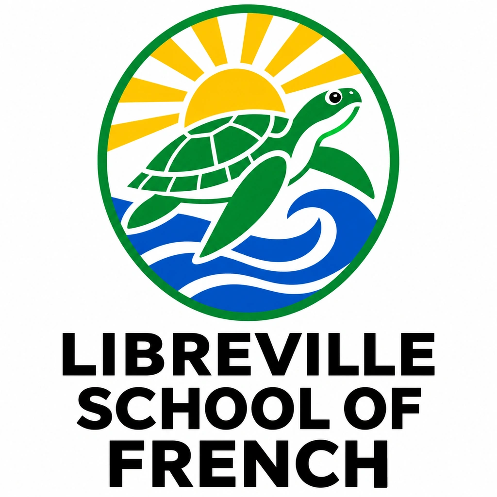
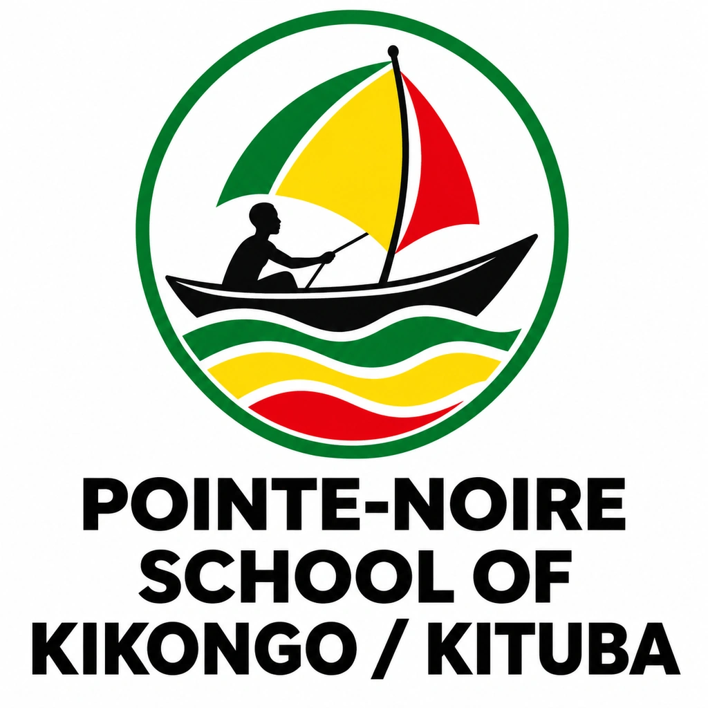
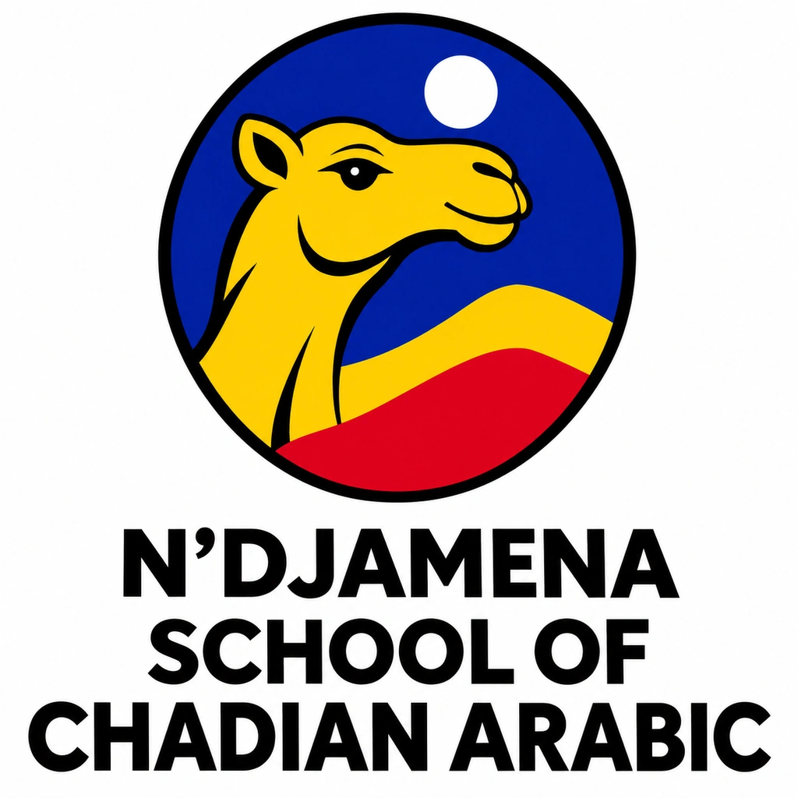
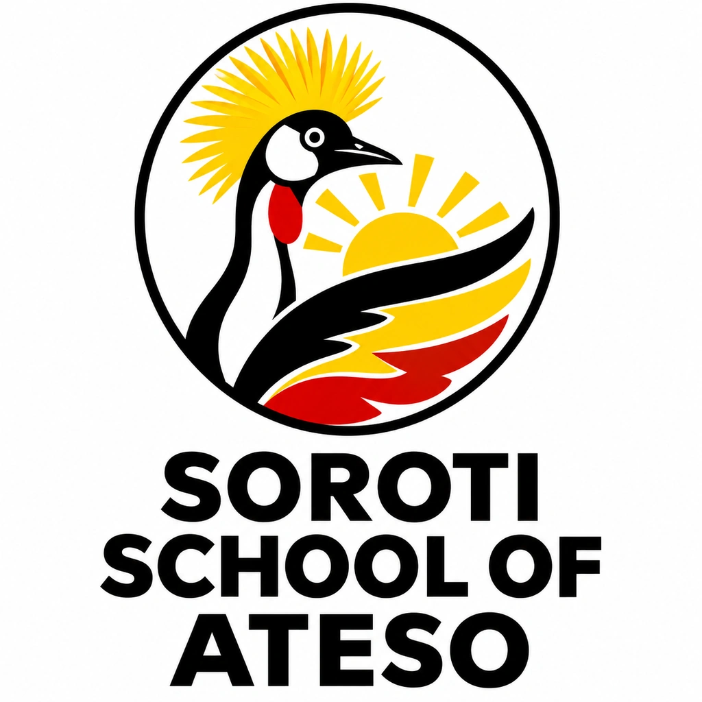

# Missing African School Logos — Batch 01

Ten new logos added without replacing existing files. White backgrounds, black school names, circular emblems using national colours.

## Oyem School of Fang

`oyemschoollogo.webp`

## Douala School of French

`doualaschoollogo.webp`

## Libreville School of French

`librevilleschoollogo.webp`

## Pointe-Noire School of Kikongo / Kituba

`pointenoireschoollogo.webp`

## Bangui School of Sango

`banguischoollogo.webp`

## Mbuji-Mayi School of Tshiluba

`mbujimayischoollogo.webp`

## N’Djamena School of Chadian Arabic

`ndjamenaschoollogo.webp`

## Soroti School of Ateso

`sorotischoollogo.webp`

## Moshi School of Chagga

`moshischoollogo.webp`

## Moroni School of Comorian

`moronischoollogo.webp`
