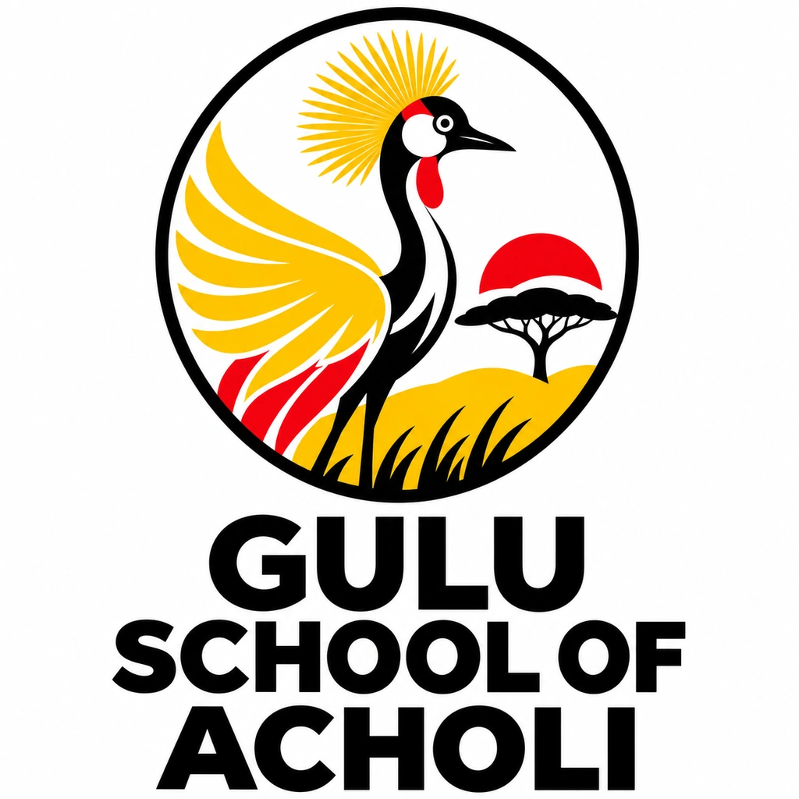
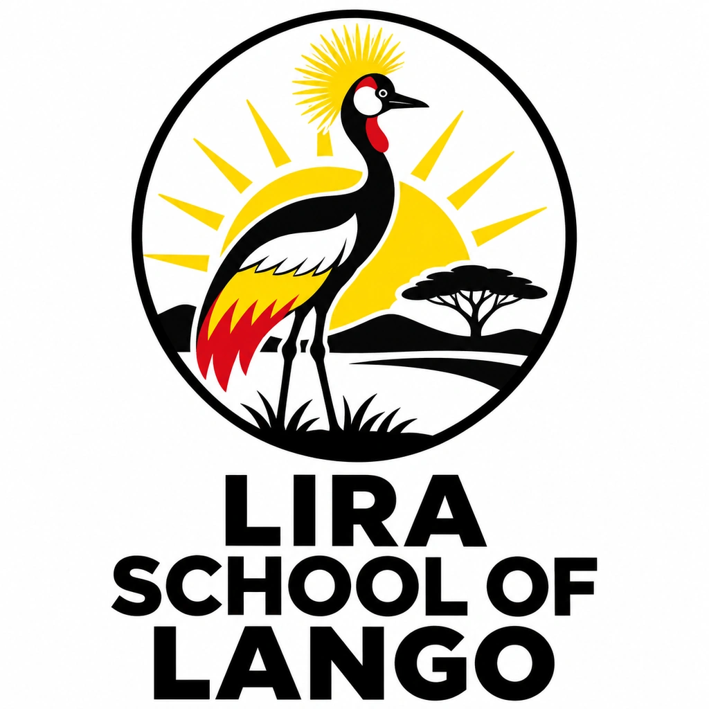

# Missing African School Logos — Batch 02

15 new square WebP school logos, 1024 × 1024. White backgrounds, black school names, circular emblems in national colours. Existing files preserved. Cities with multiple languages use separate citylanguageschoollogo.webp filenames.

## Luanda School of Kimbundu

`luandakimbunduschoollogo.webp`

## Gulu School of Acholi

`guluacholischoollogo.webp`

## Gulu School of English

`guluenglishschoollogo.webp`

## Kisumu School of Dholuo

`kisumudholuoschoollogo.webp`

## Kisumu School of English

`kisumuenglishschoollogo.webp`

## Dodoma School of Gogo

`dodomaschoollogo.webp`

## Bukoba School of Haya

`bukobaschoollogo.webp`

## Iringa School of Hehe

`iringaschoollogo.webp`

## Eldoret School of Kalenjin

`eldoretkalenjinschoollogo.webp`

## Eldoret School of English

`eldoretenglishschoollogo.webp`

## Machakos School of Kamba

`machakosschoollogo.webp`

## Nyeri School of Kikuyu

`nyerischoollogo.webp`

## Meru School of Kimeru

`meruschoollogo.webp`

## Kigali School of English

`kigalienglishschoollogo.webp`

## Lira School of Lango

`liraschoollogo.webp`
