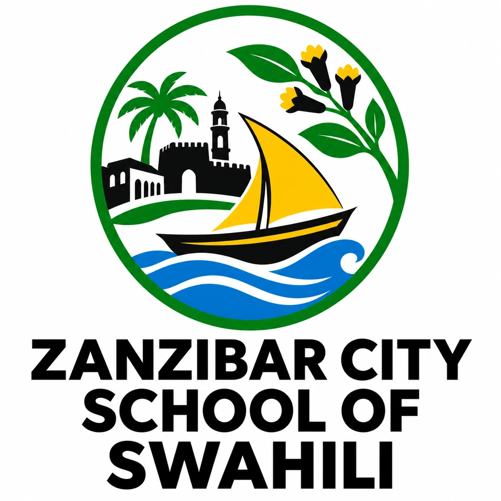
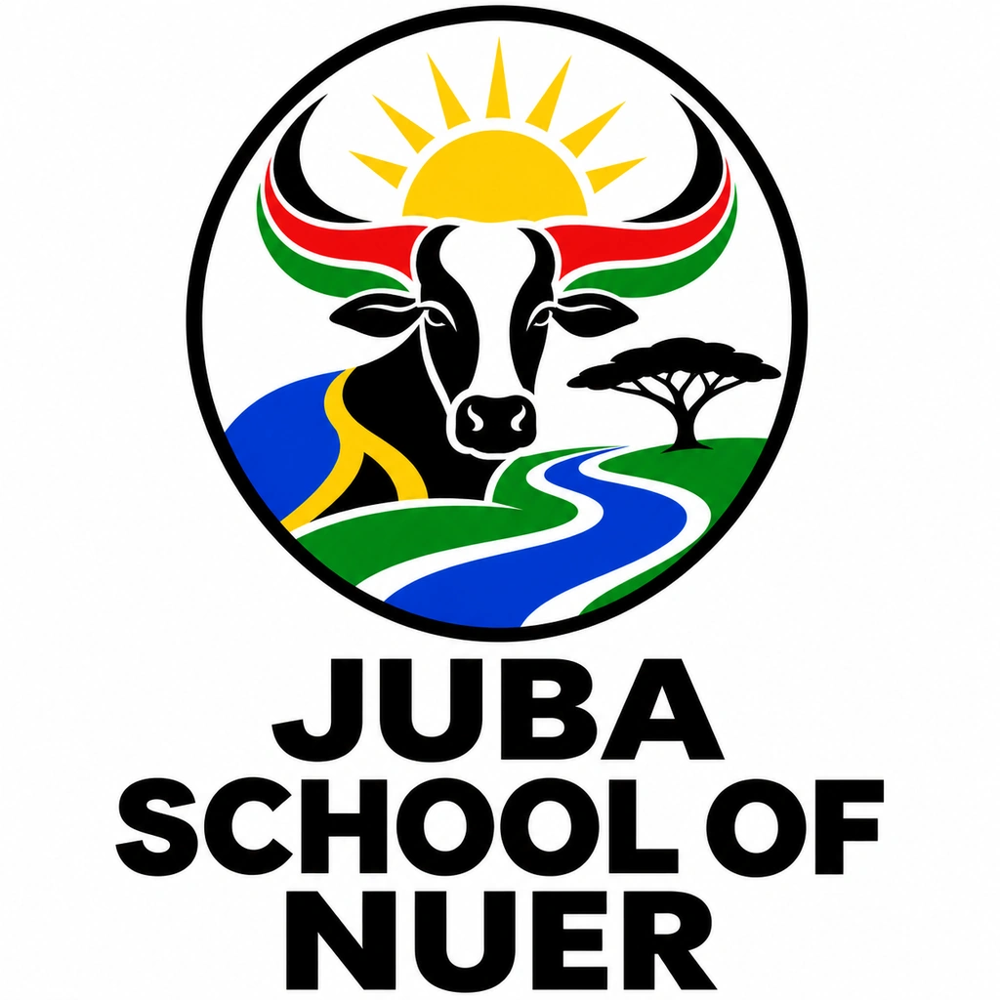
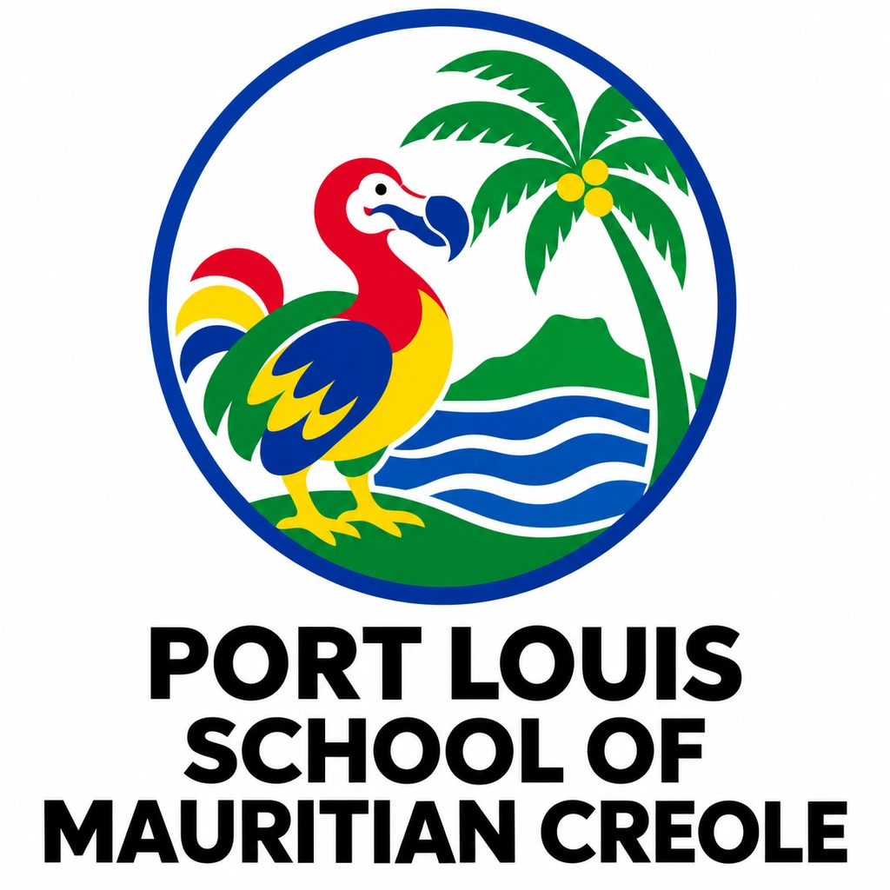
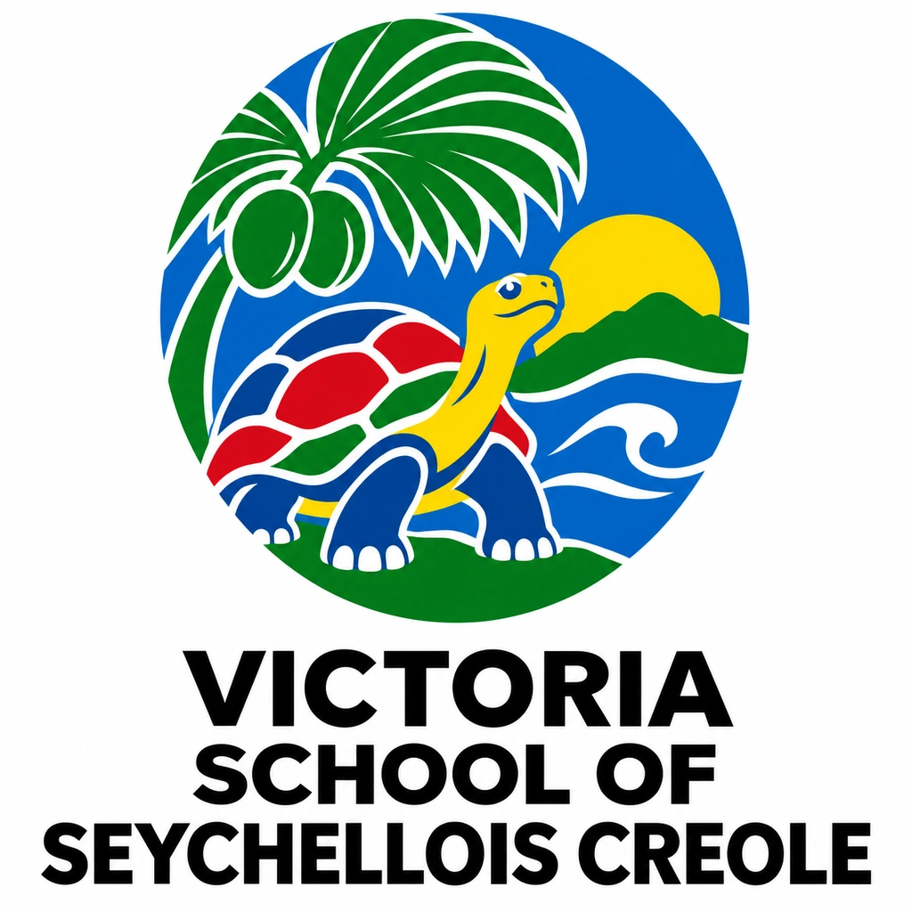
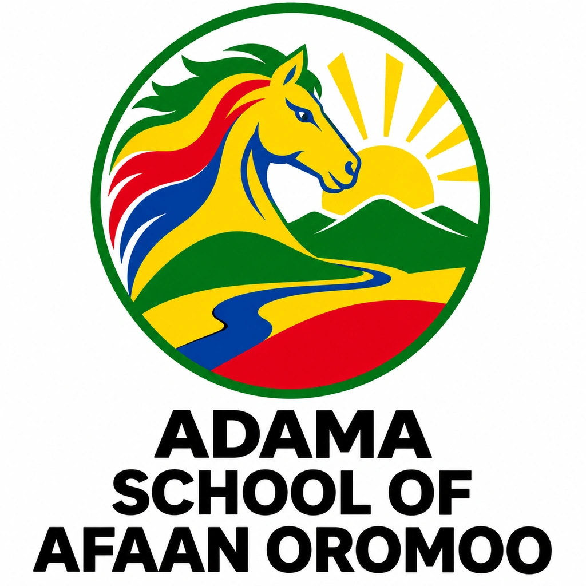
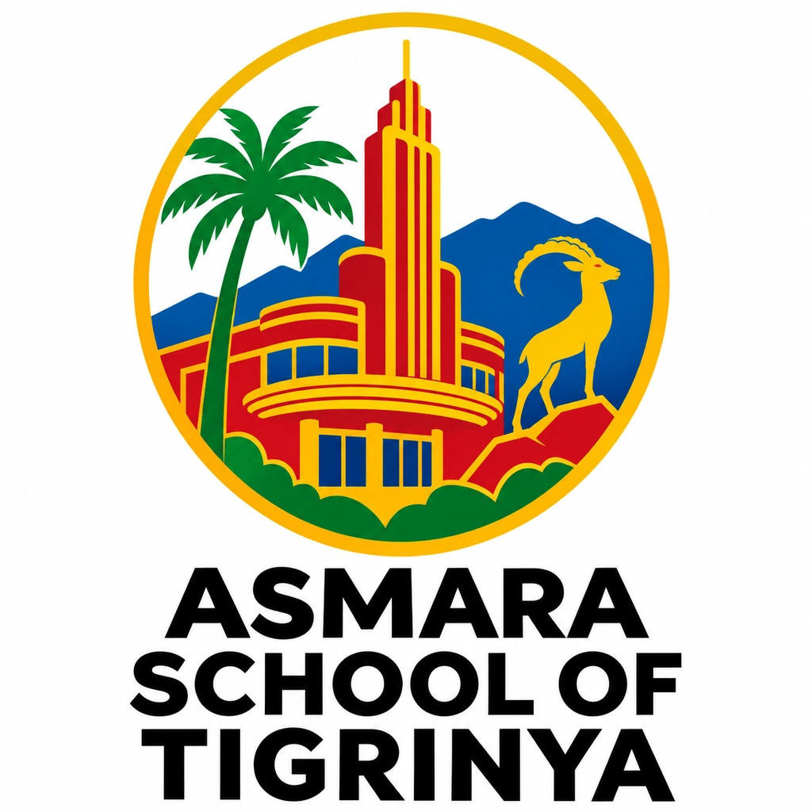
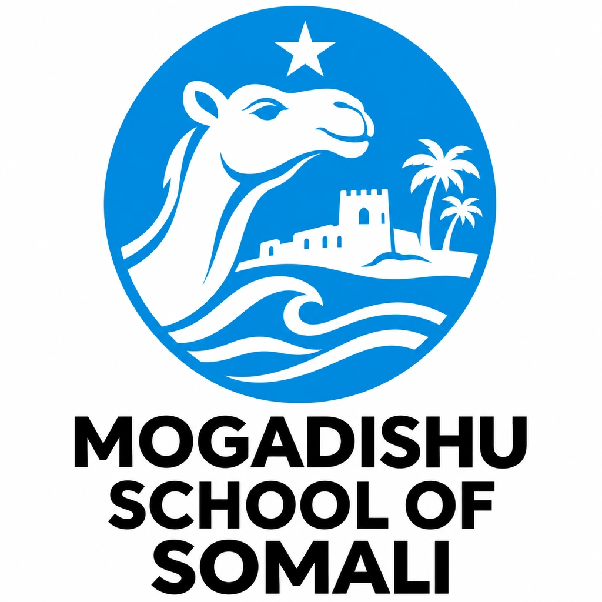
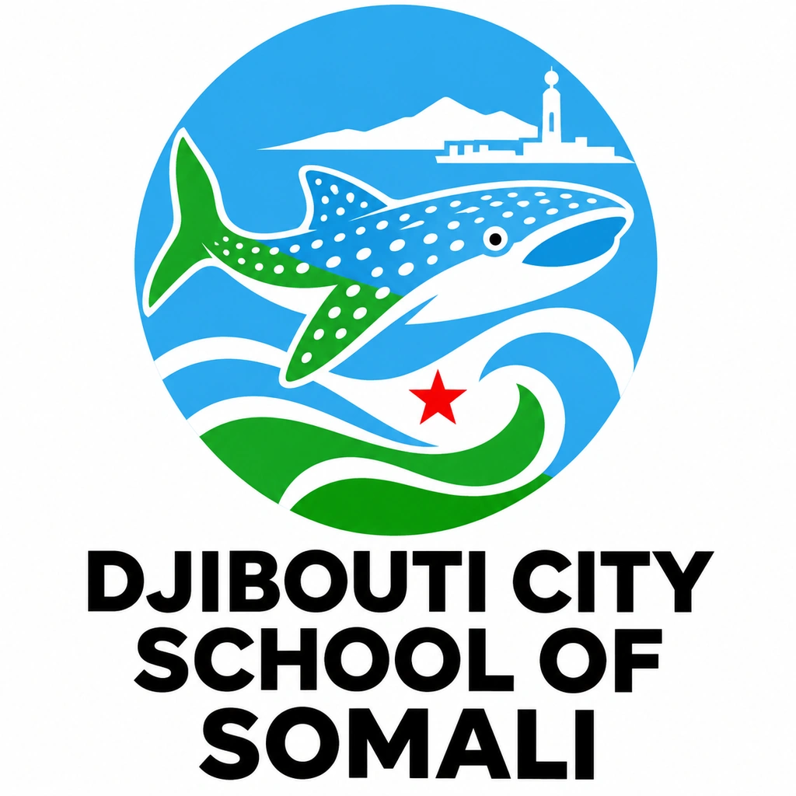

# African School Logos — Batch 04

10 new schools teaching languages other than English. Square 1024 × 1024 WebP logos. White backgrounds, black school names, circular emblems in national colours. Existing files preserved.

## Zanzibar City School of Swahili

`zanzibarcityschoollogo.webp`

## Sodo School of Wolaytta

`sodoschoollogo.webp`

## Juba School of Nuer

`jubaschoollogo.webp`

## Port Louis School of Mauritian Creole

`portlouisschoollogo.webp`

## Victoria School of Seychellois Creole

`victoriaschoollogo.webp`

## Adama School of Afaan Oromoo

`adamaschoollogo.webp`

## Semera School of Afar

`semeraschoollogo.webp`

## Asmara School of Tigrinya

`asmaraschoollogo.webp`

## Mogadishu School of Somali

`mogadishuschoollogo.webp`

## Djibouti City School of Somali

`djibouticityschoollogo.webp`
