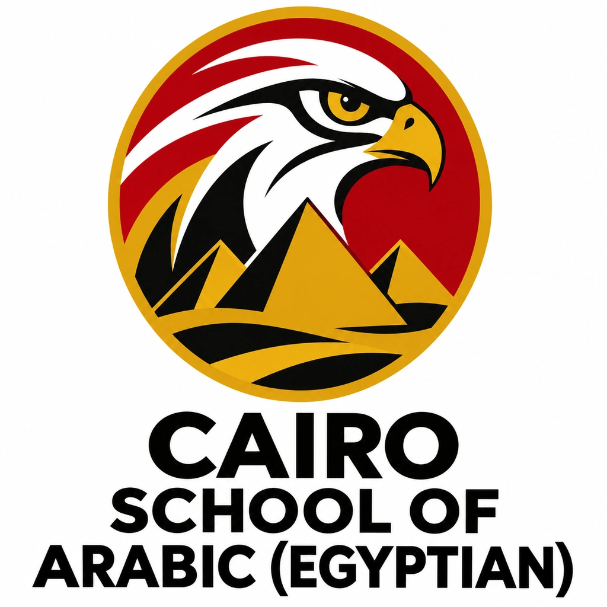
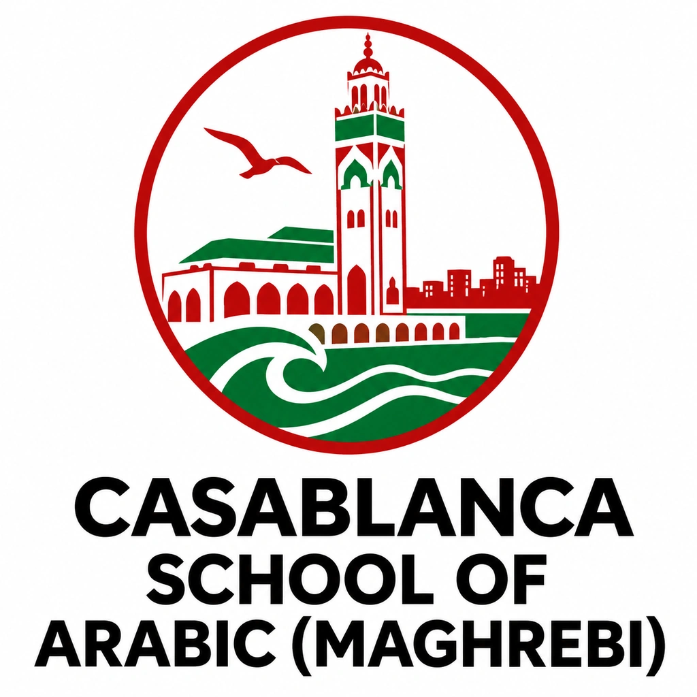
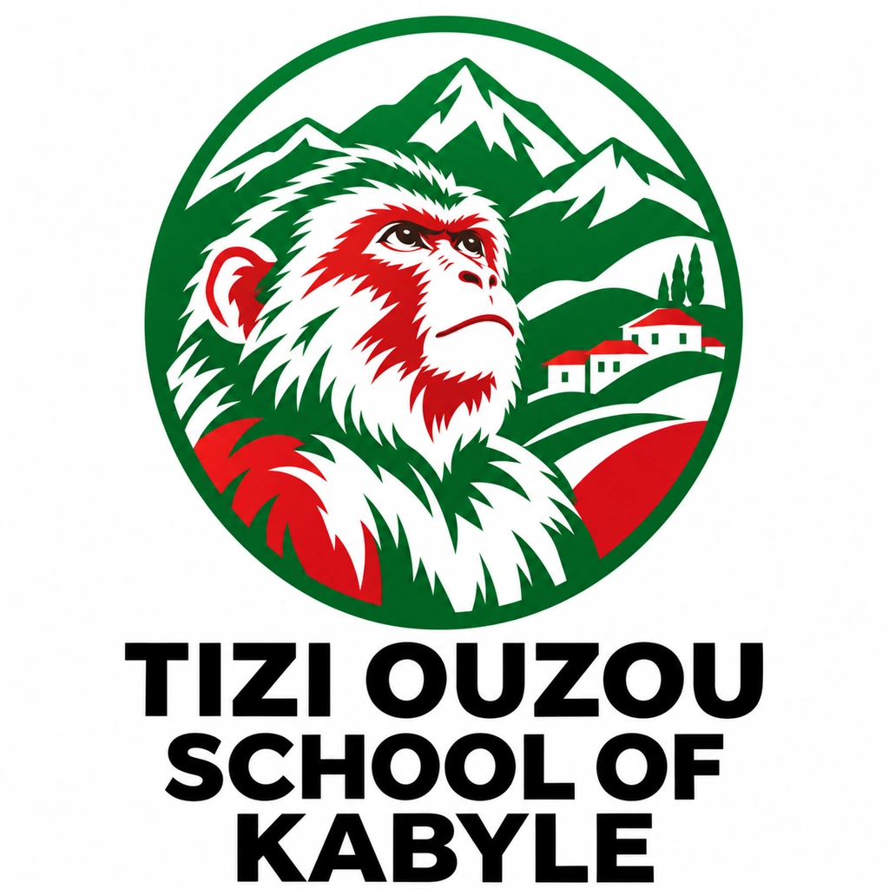
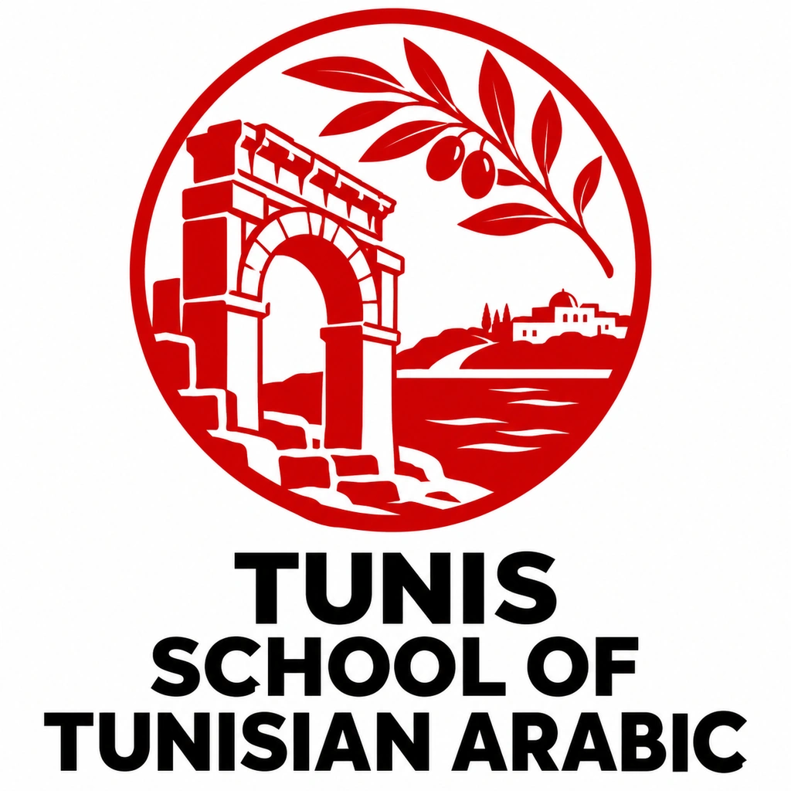
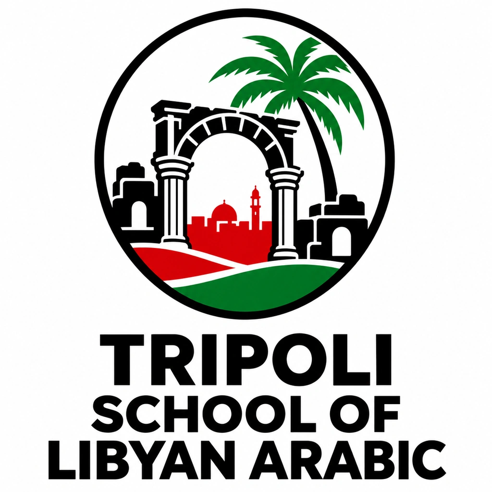
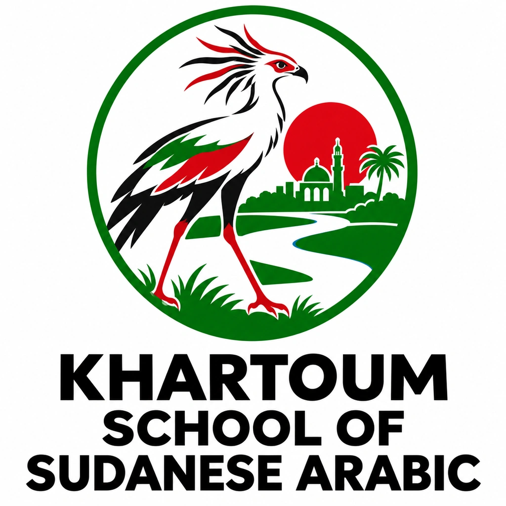
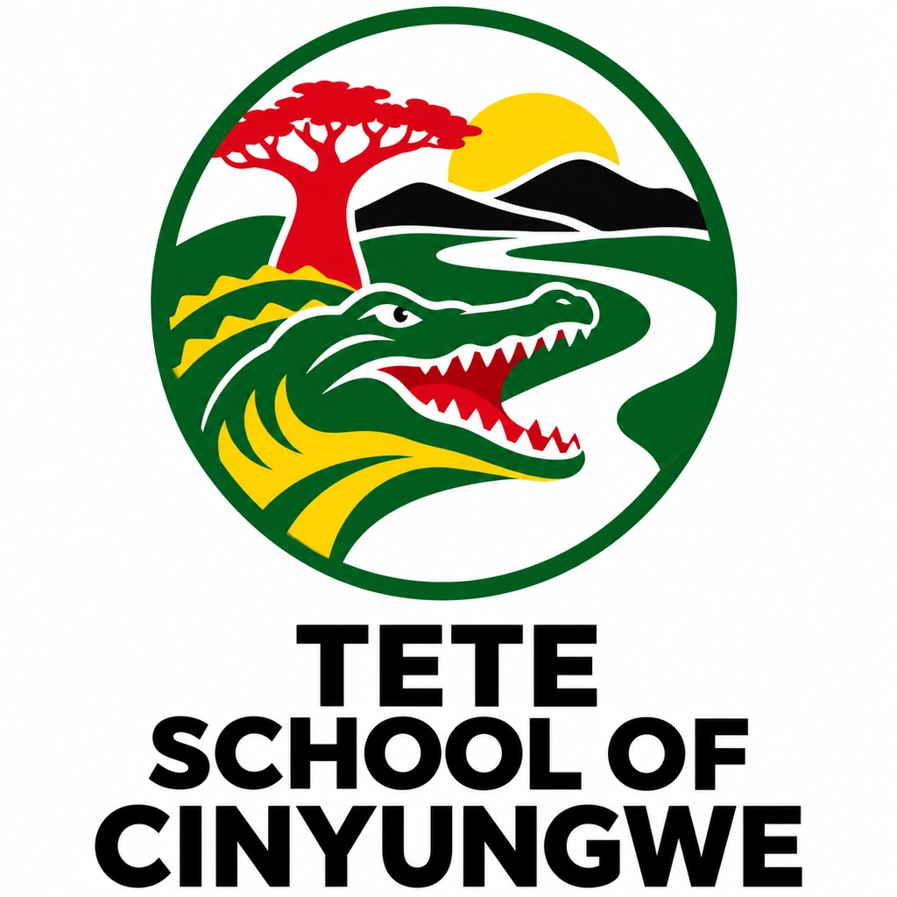

# african School Logos — Batch 05

10 new square 1024 × 1024 WebP logos. White backgrounds, black school names, circular emblems in national colours. Existing files preserved.

## Cairo School of Arabic (Egyptian)

`cairoschoollogo.webp`

## Casablanca School of Arabic (Maghrebi)

`casablancaschoollogo.webp`

## Tizi Ouzou School of Kabyle

`tiziouzouschoollogo.webp`

## Nador School of Tarifit

`nadorschoollogo.webp`

## Tangier School of Tarifit

`tangierschoollogo.webp`

## Tunis School of Tunisian Arabic

`tunisschoollogo.webp`

## Tripoli School of Libyan Arabic

`tripolischoollogo.webp`

## Khartoum School of Sudanese Arabic

`khartoumschoollogo.webp`

## Kasama School of Bemba

`kasamaschoollogo.webp`

## Tete School of Cinyungwe

`teteschoollogo.webp`
