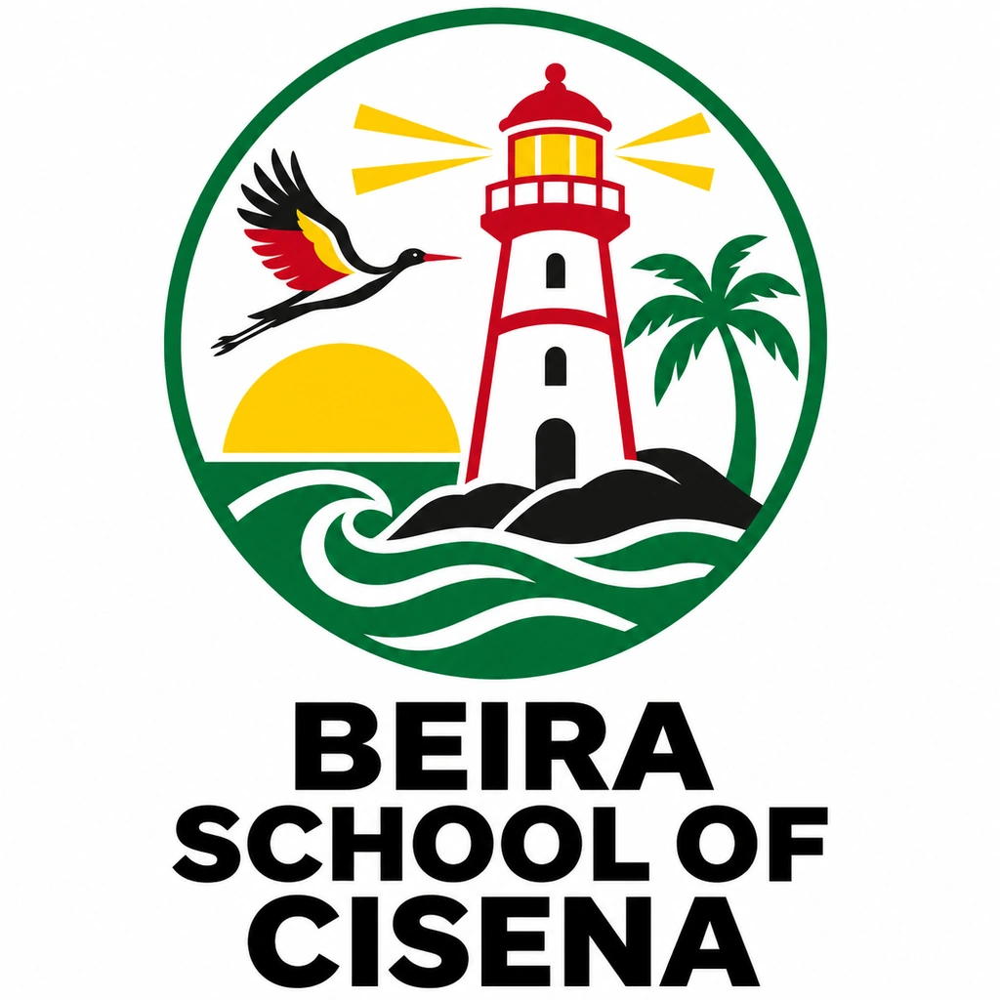
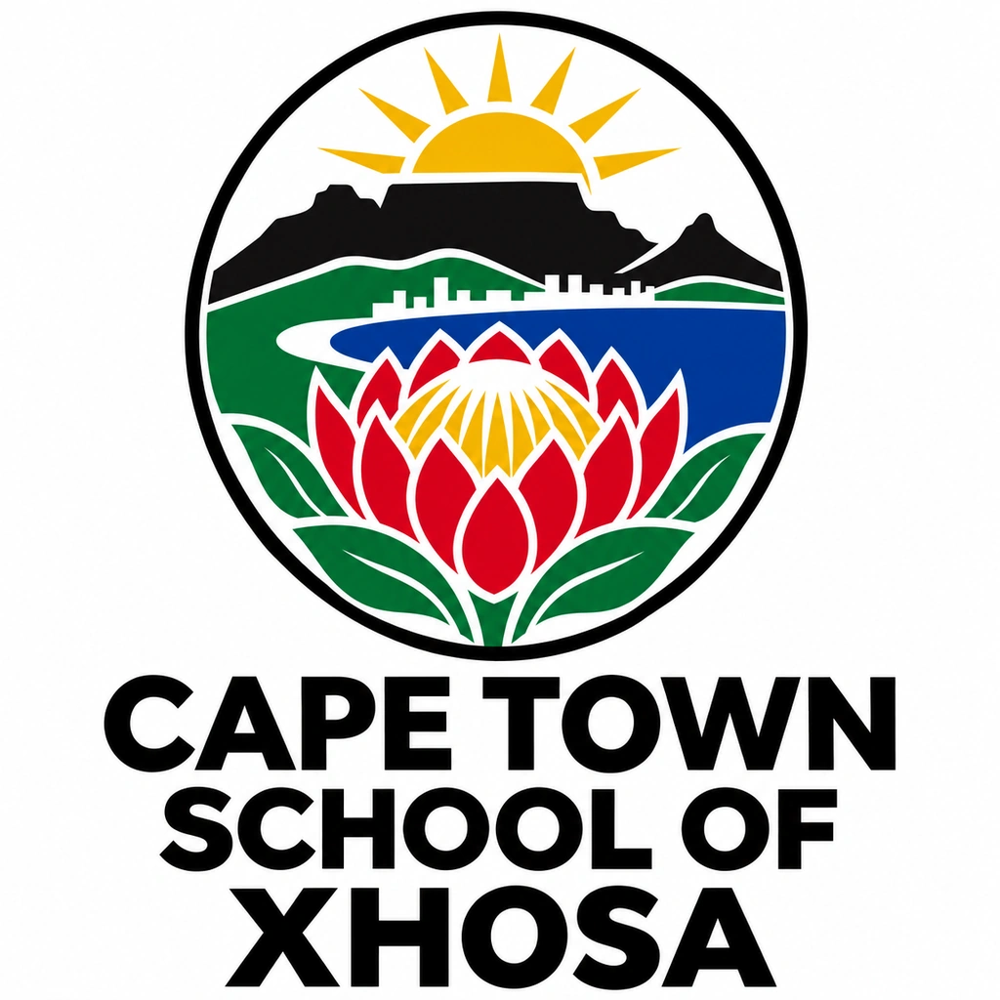
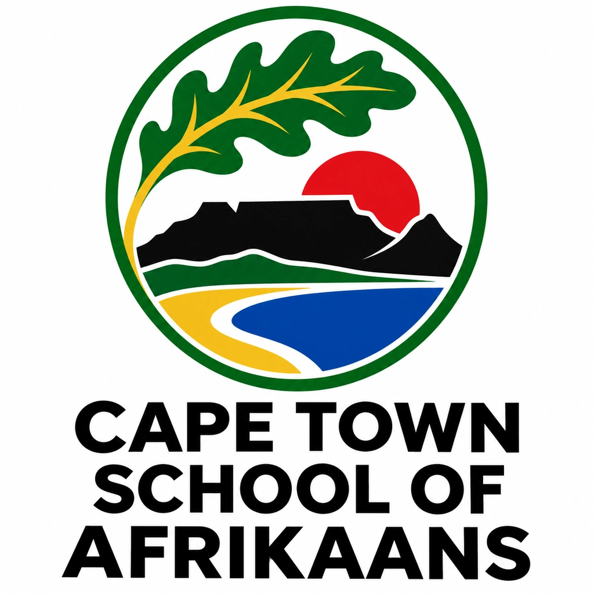
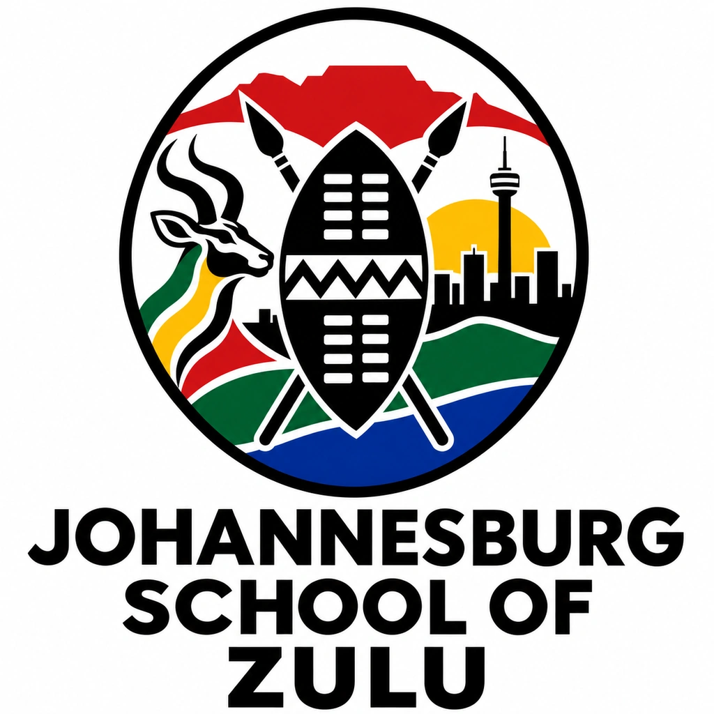
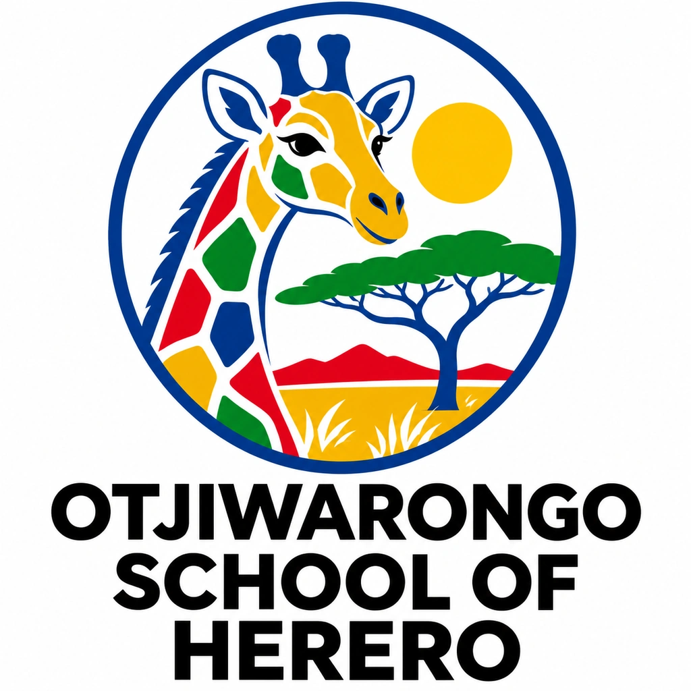
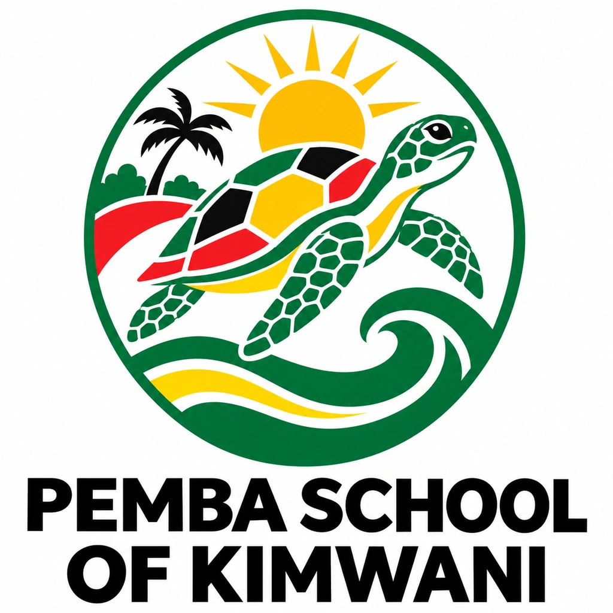
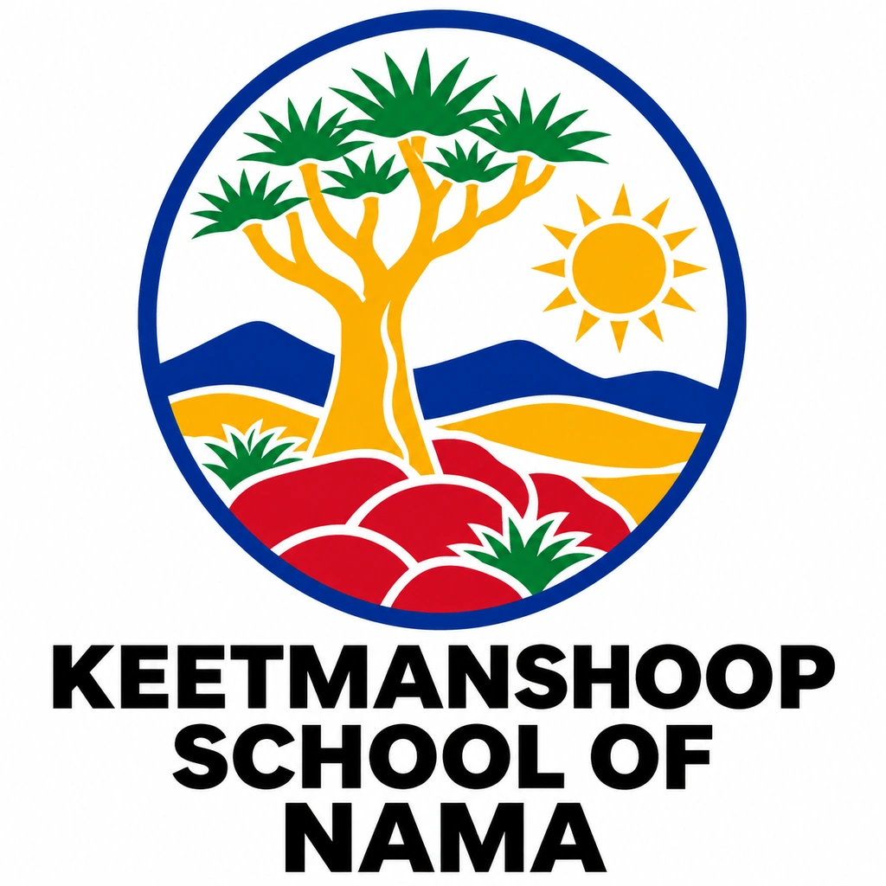

# african School Logos — Batch 06

10 new square 1024 × 1024 WebP logos. White backgrounds, black school names, circular emblems in national colours. Existing files preserved.

## Beira School of Cisena

`beiraschoollogo.webp`

## Nampula School of Emakhuwa

`nampulaschoollogo.webp`

## Cape Town School of Xhosa

`capetownxhosaschoollogo.webp`

## Cape Town School of Afrikaans

`capetownafrikaansschoollogo.webp`

## Johannesburg School of Zulu

`johannesburgzuluschoollogo.webp`

## Otjiwarongo School of Herero

`otjiwarongoschoollogo.webp`

## Pemba School of Kimwani

`pembaschoollogo.webp`

## Mtwara School of Makonde

`mtwaraschoollogo.webp`

## Keetmanshoop School of Nama

`keetmanshoopschoollogo.webp`

## Windhoek School of Oshiwambo

`windhoekschoollogo.webp`
