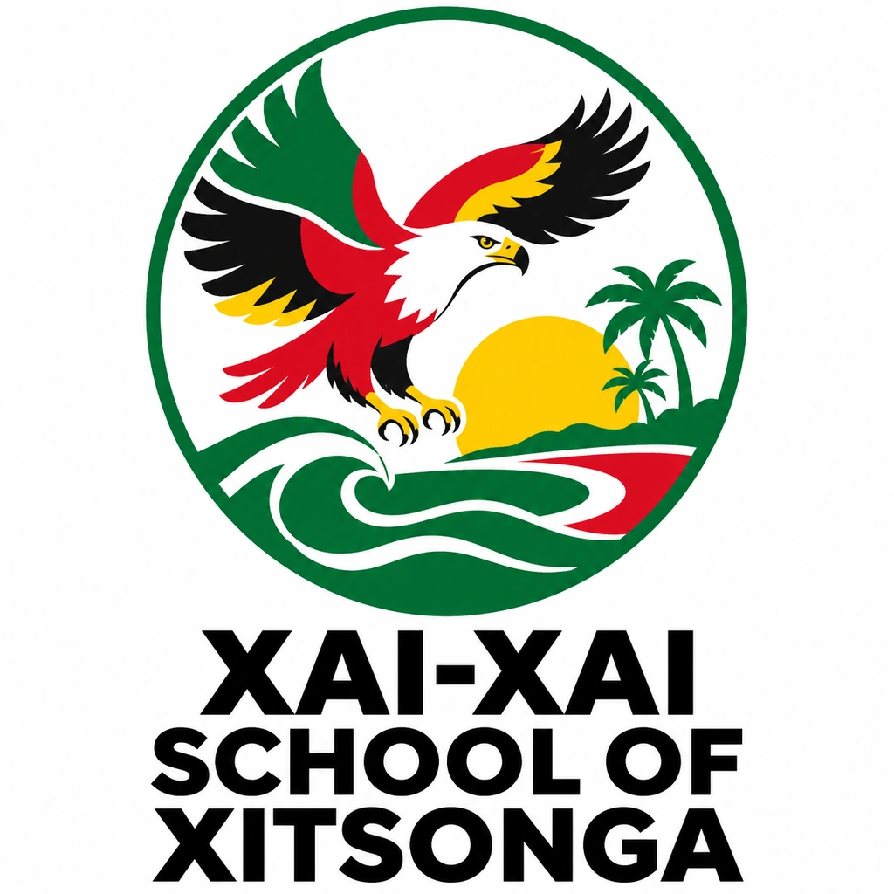
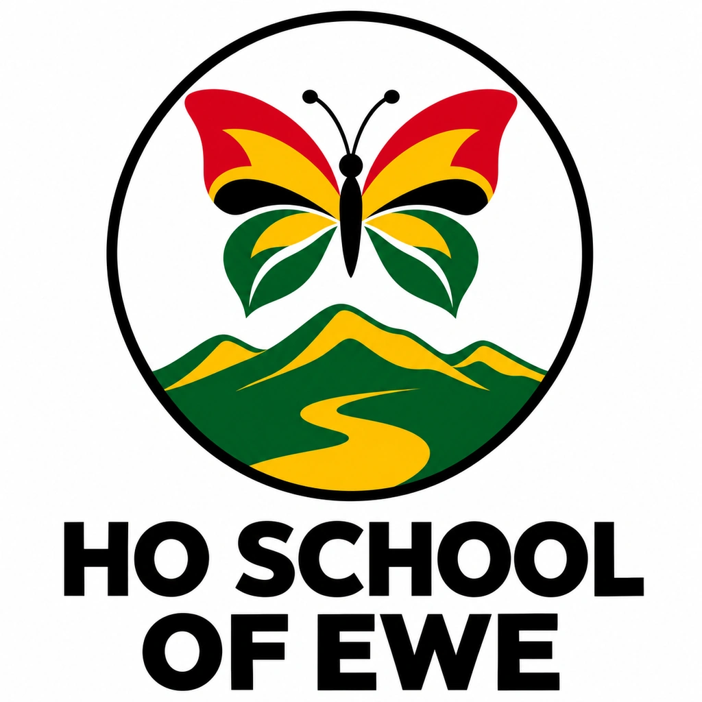
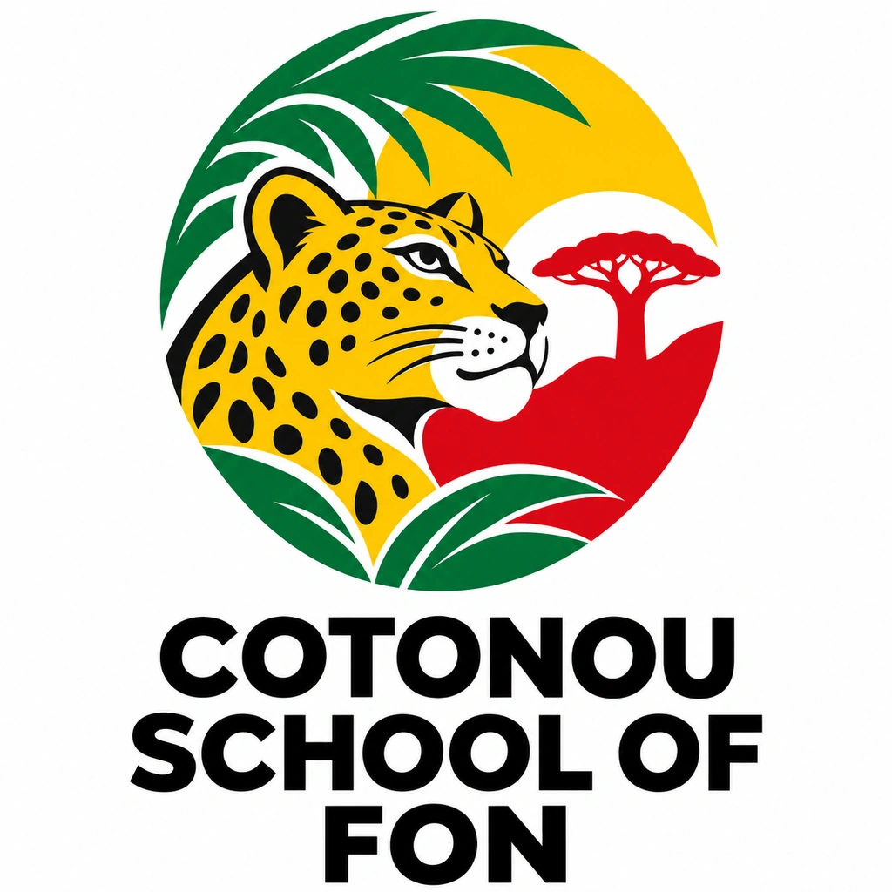
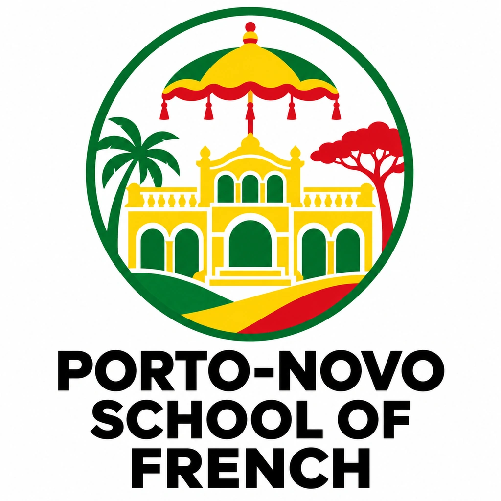
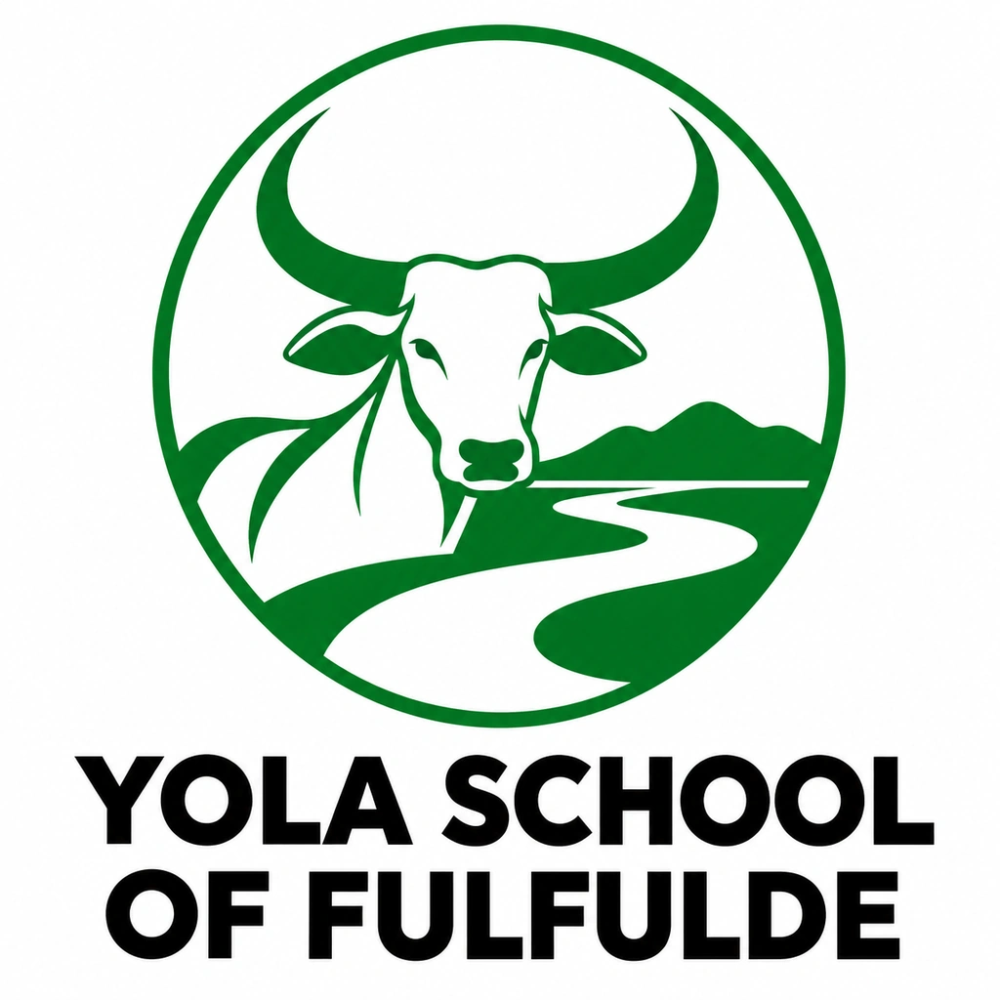
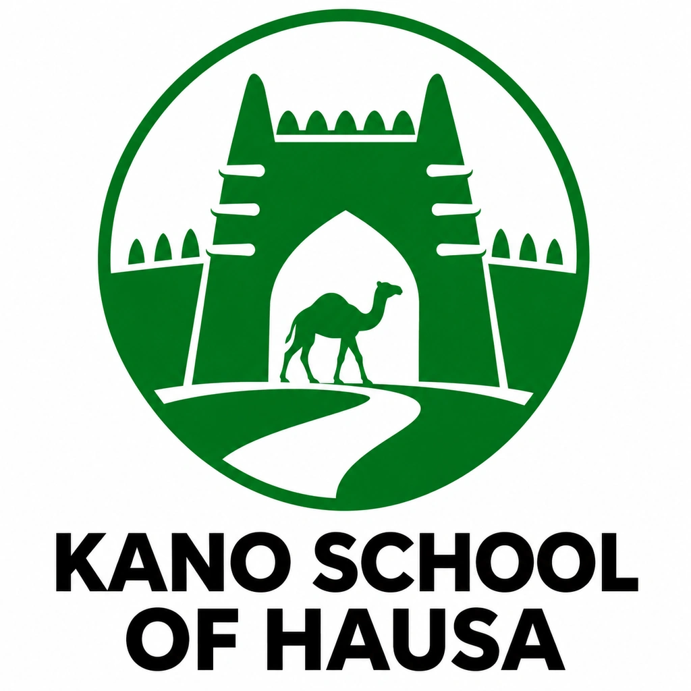

# African school logos — batch 07

## Polokwane School of Sepedi

`polokwaneschoollogo.webp`

## Pretoria School of Sepedi

`pretoriaschoollogo.webp`

## Pretoria School of Afrikaans

`pretoriaafrikaansschoollogo.webp`

## Thohoyandou School of Tshivenda

`thohoyandouschoollogo.webp`

## Huambo School of Umbundu

`huamboschoollogo.webp`

## Mthatha School of Xhosa

`mthathaschoollogo.webp`

## Xai-Xai School of Xitsonga

`xaixaischoollogo.webp`

## Mangochi School of Yao / Chiyao

`mangochischoollogo.webp`

## Tamale School of Dagbani

`tamaleschoollogo.webp`

## Ho School of Ewe

`hoschoollogo.webp`

## Cotonou School of Fon

`cotonouschoollogo.webp`

## Cotonou School of French

`cotonoufrenchschoollogo.webp`

## Porto-Novo School of French

`portonovoschoollogo.webp`

## Yola School of Fulfulde

`yolaschoollogo.webp`

## Kano School of Hausa

`kanoschoollogo.webp`
