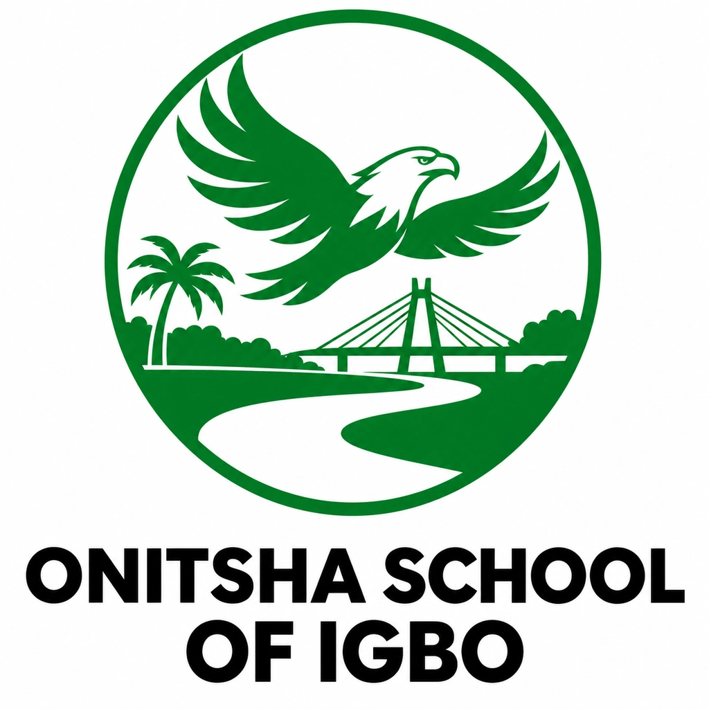
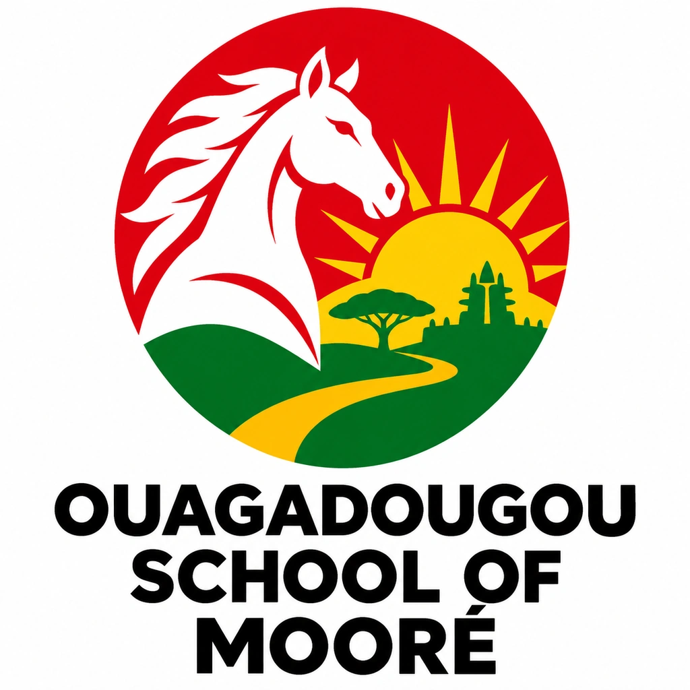
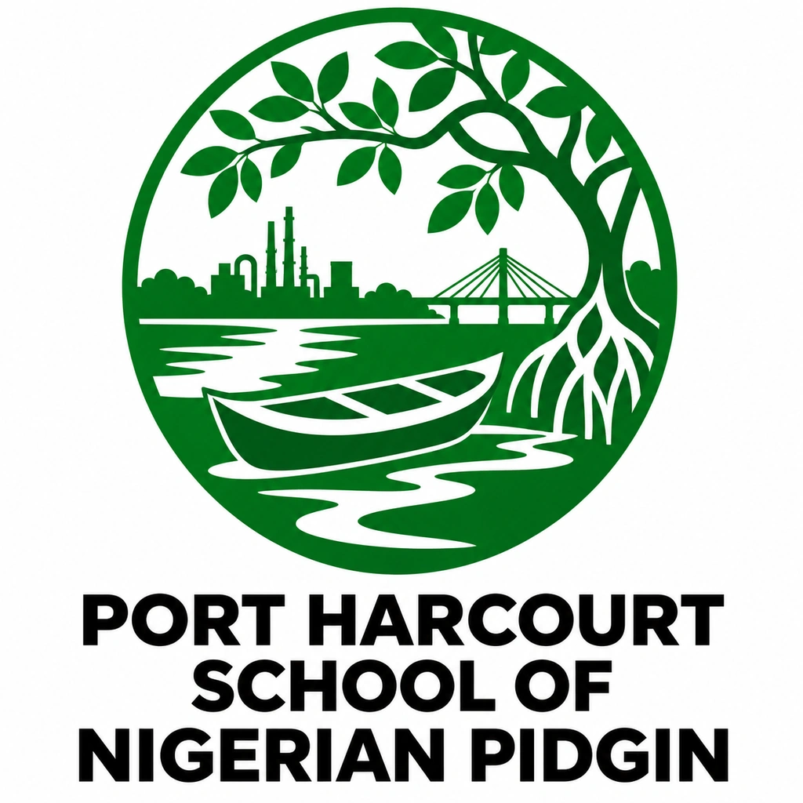
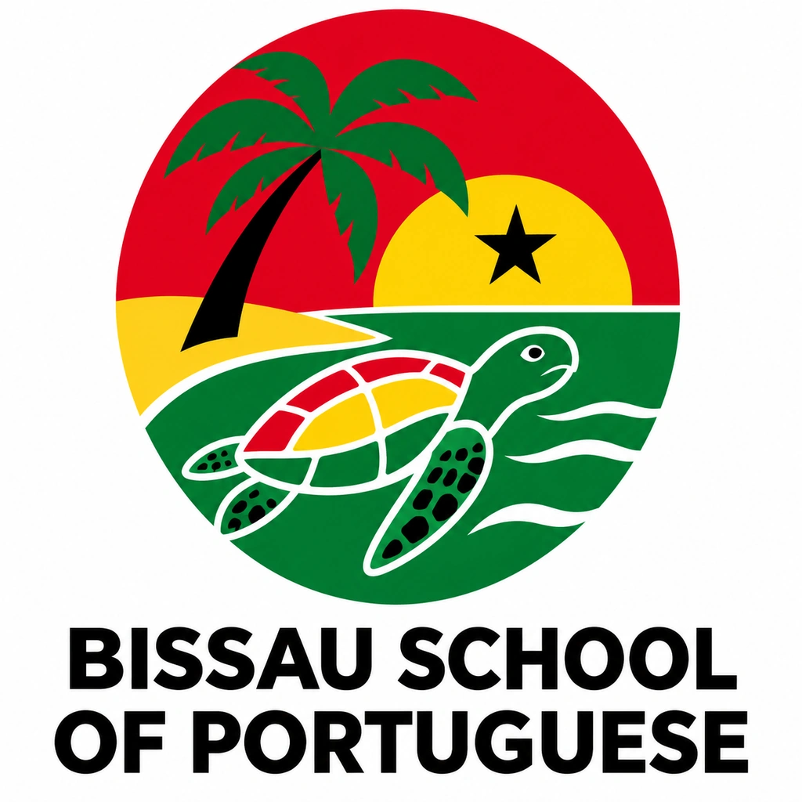
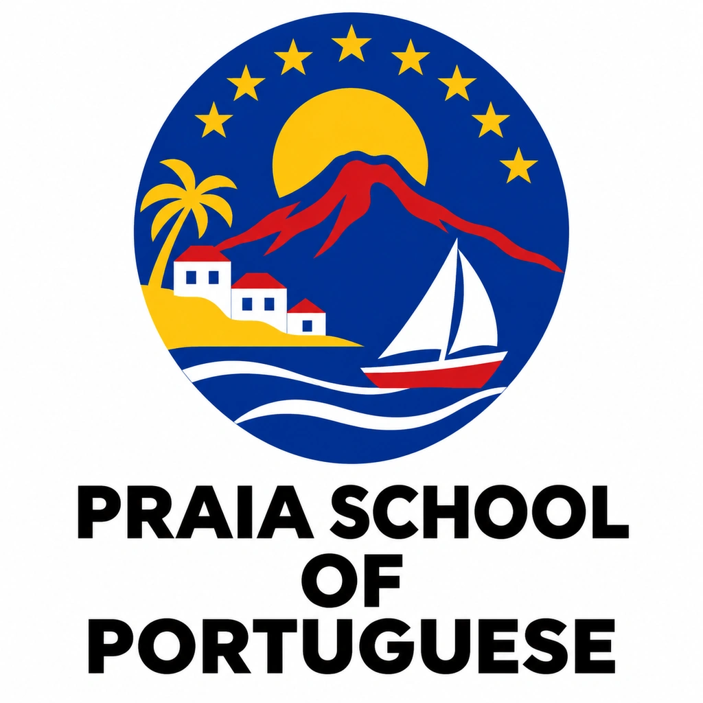
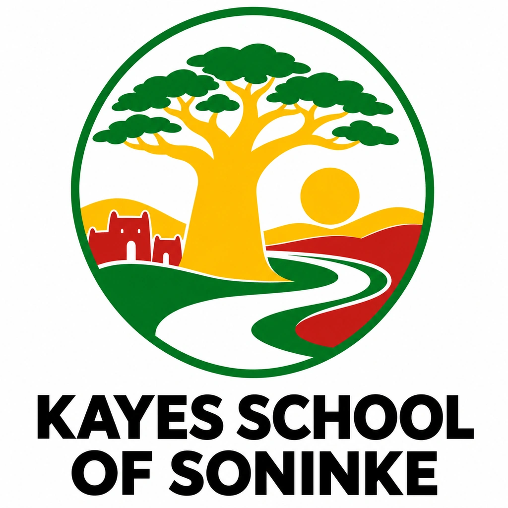
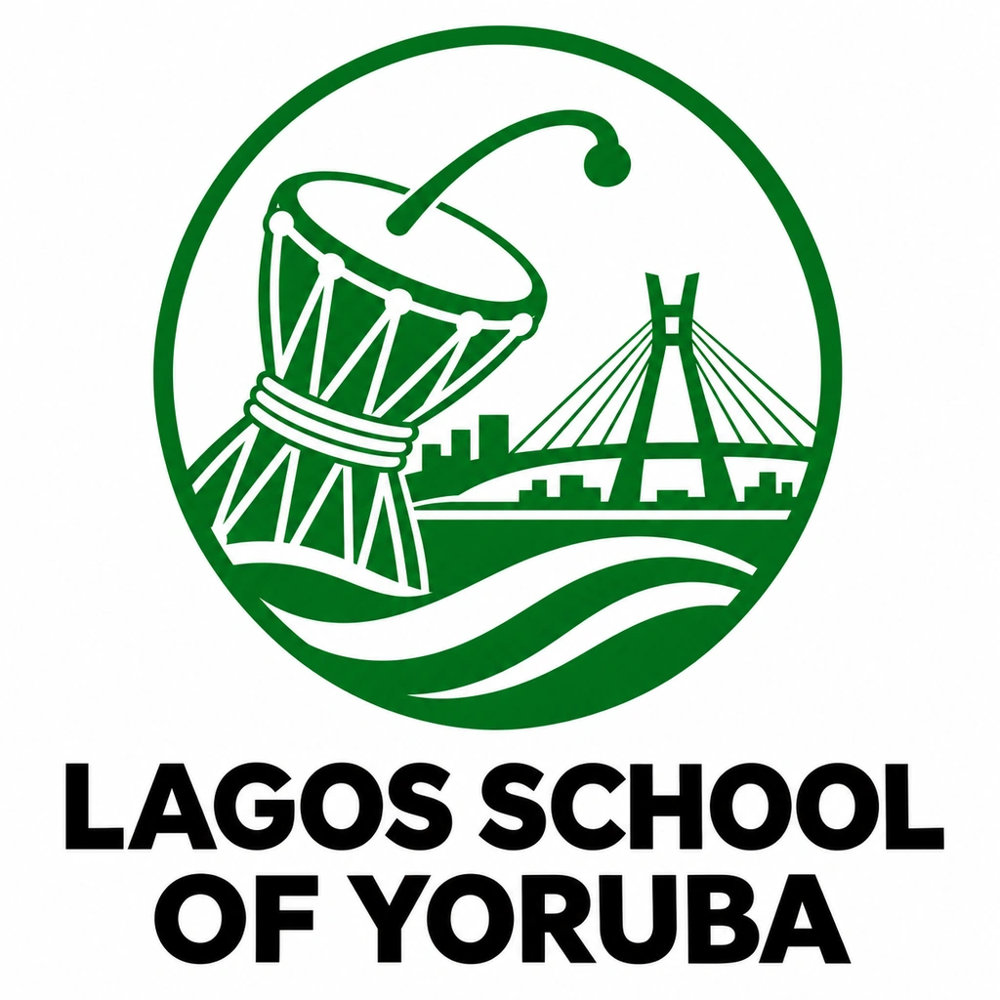
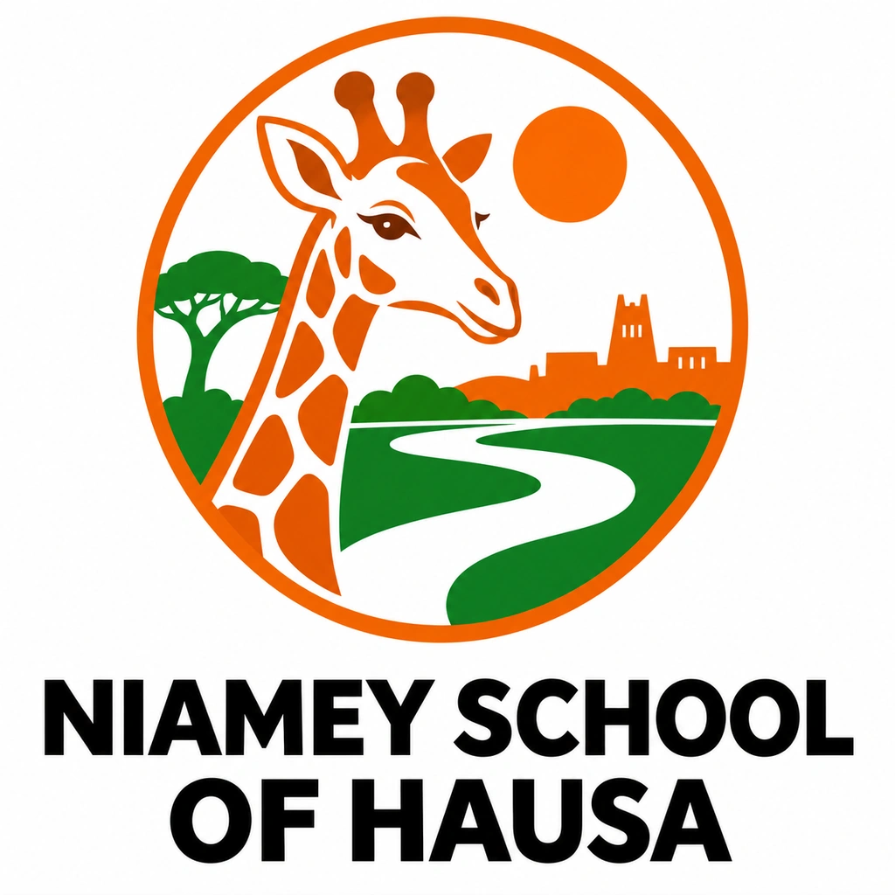
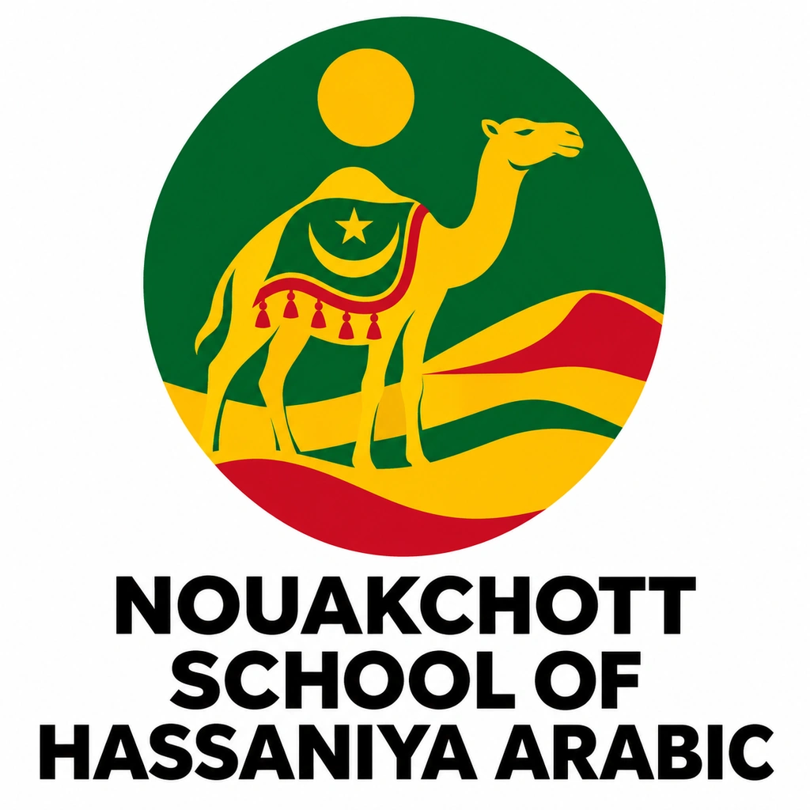
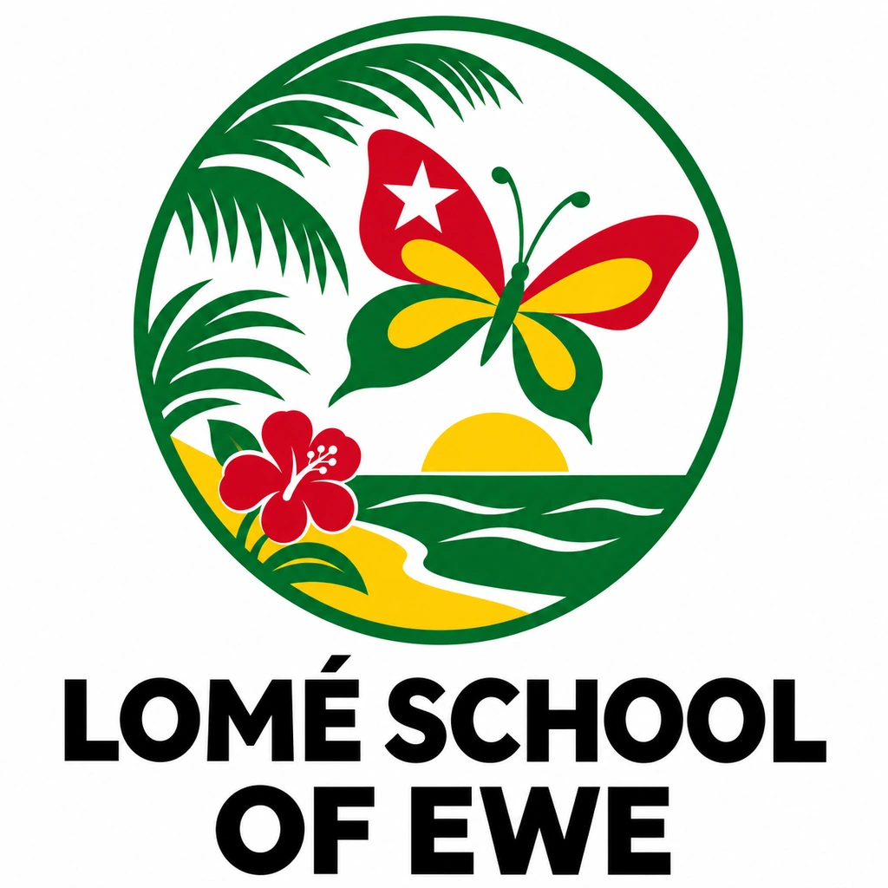

# African school logos — batch 08

## Uyo School of Ibibio

`uyoschoollogo.webp`

## Onitsha School of Igbo

`onitshaschoollogo.webp`

## Maiduguri School of Kanuri

`maidugurischoollogo.webp`

## Banjul School of Mandinka

`banjulschoollogo.webp`

## Ouagadougou School of Mooré

`ouagadougouschoollogo.webp`

## Port Harcourt School of Nigerian Pidgin

`portharcourtschoollogo.webp`

## Bissau School of Portuguese

`bissauschoollogo.webp`

## Praia School of Portuguese

`praiaschoollogo.webp`

## Kayes School of Soninke

`kayesschoollogo.webp`

## Makurdi School of Tiv

`makurdischoollogo.webp`

## Lagos School of Yoruba

`lagosschoollogo.webp`

## Conakry School of Susu

`conakryschoollogo.webp`

## Niamey School of Hausa

`niameyschoollogo.webp`

## Nouakchott School of Hassaniya Arabic

`nouakchottschoollogo.webp`

## Lomé School of Ewe

`lomeschoollogo.webp`
