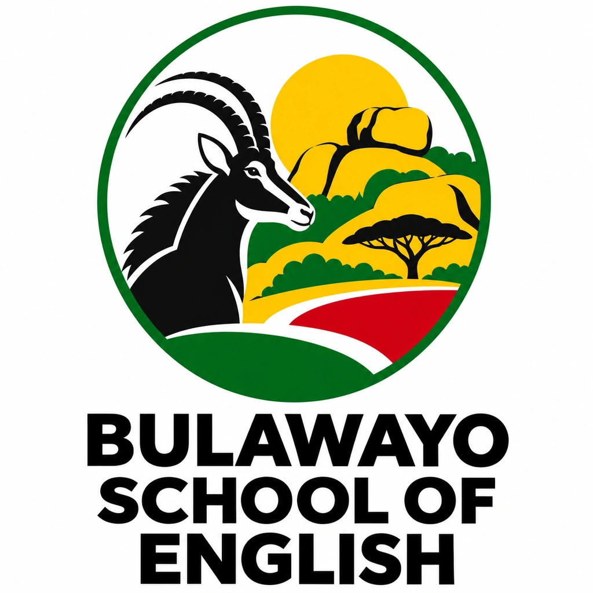
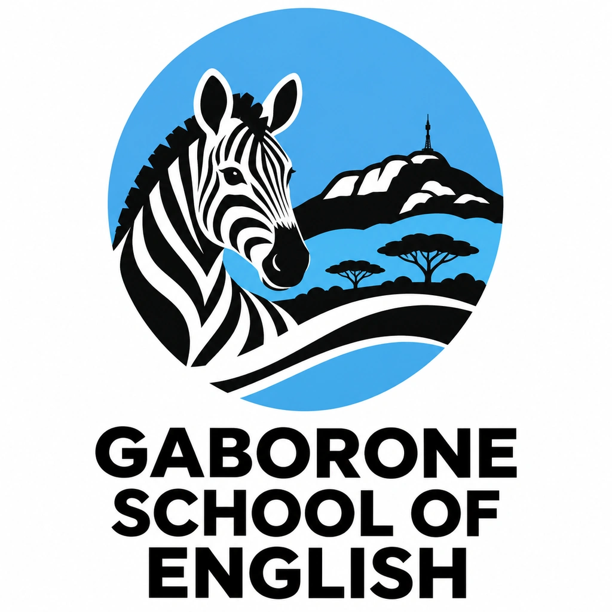
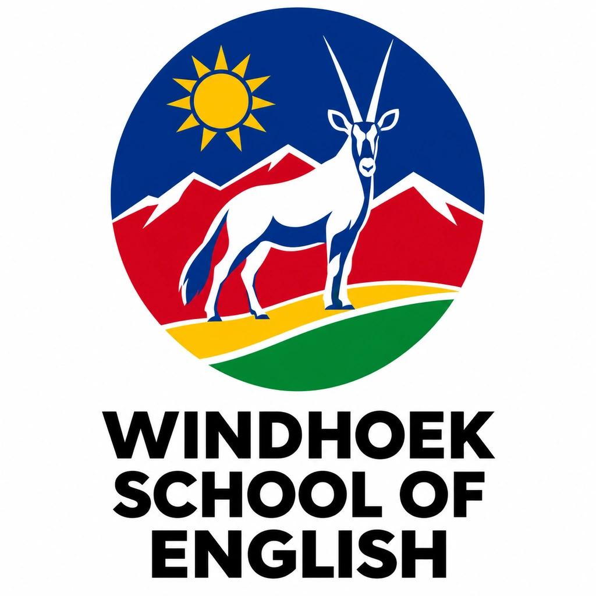
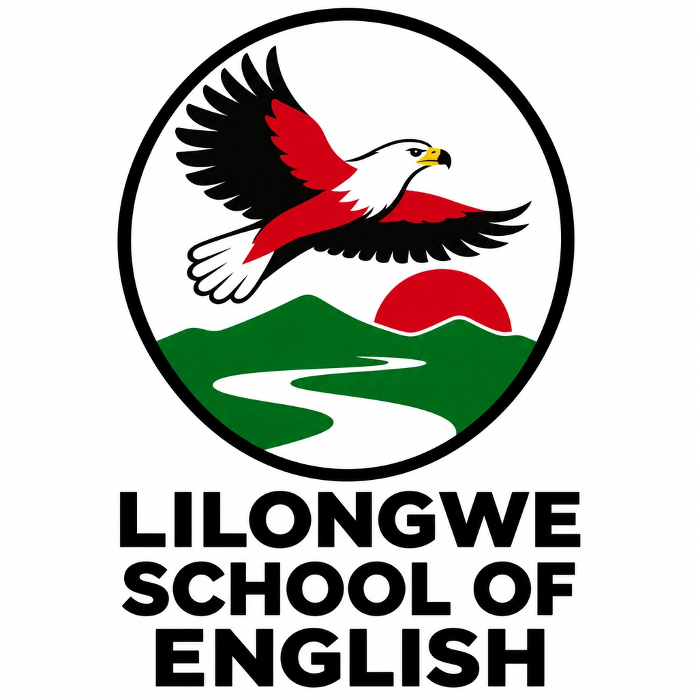
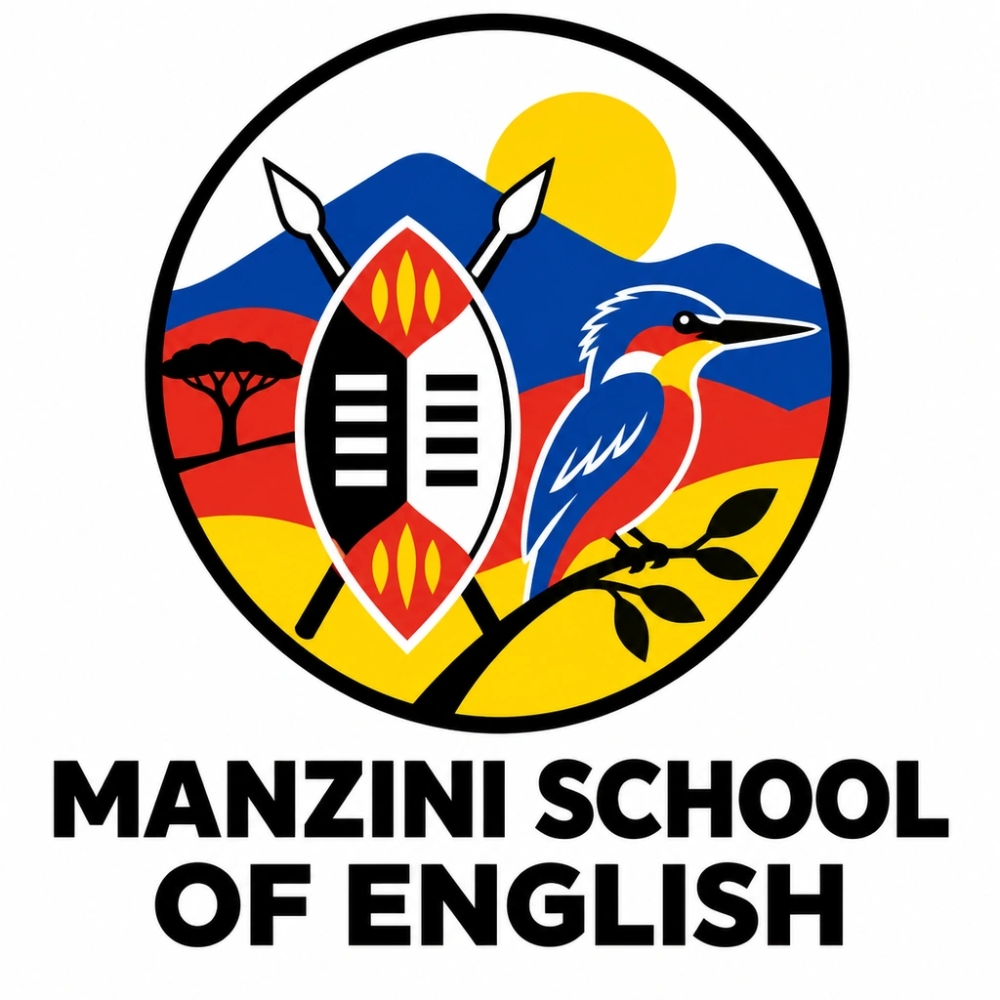
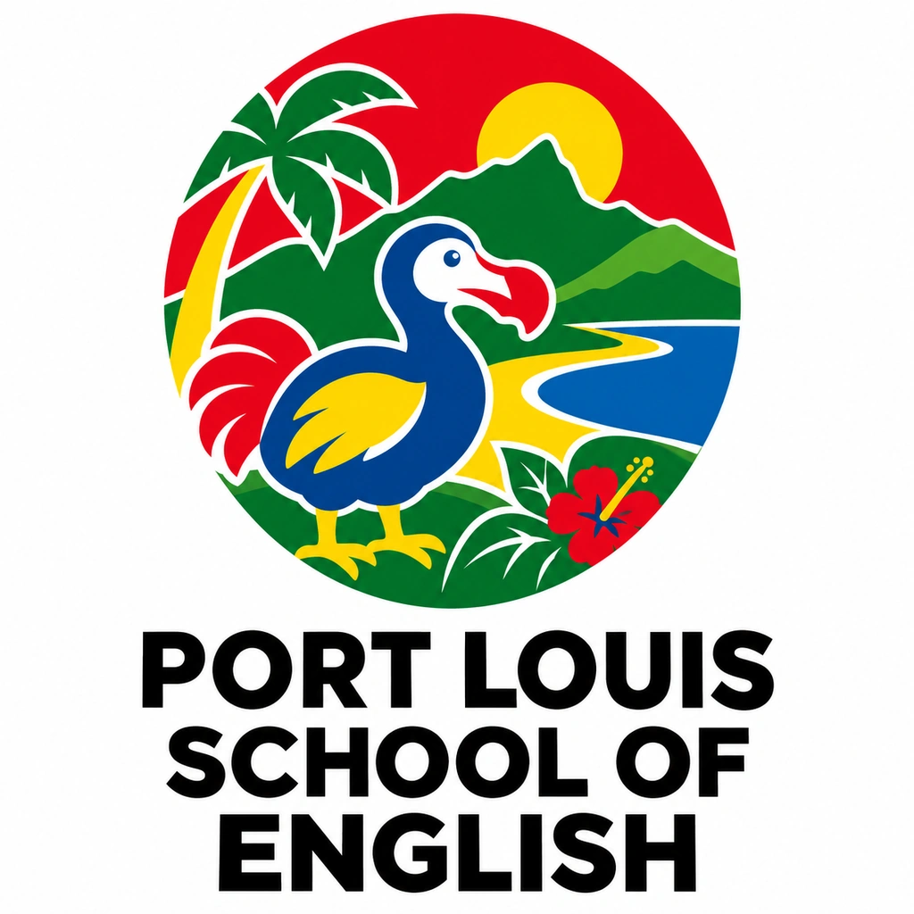

# African school logos — batch 10

## Lusaka School of English

`lusakaenglishschoollogo.webp`

## Harare School of English

`harareenglishschoollogo.webp`

## Bulawayo School of English

`bulawayoenglishschoollogo.webp`

## Gaborone School of English

`gaboroneenglishschoollogo.webp`

## Windhoek School of English

`windhoekenglishschoollogo.webp`

## Lilongwe School of English

`lilongweenglishschoollogo.webp`

## Maseru School of English

`maseruenglishschoollogo.webp`

## Mbabane School of English

`mbabaneenglishschoollogo.webp`

## Manzini School of English

`manzinienglishschoollogo.webp`

## Port Louis School of English

`portlouisenglishschoollogo.webp`
