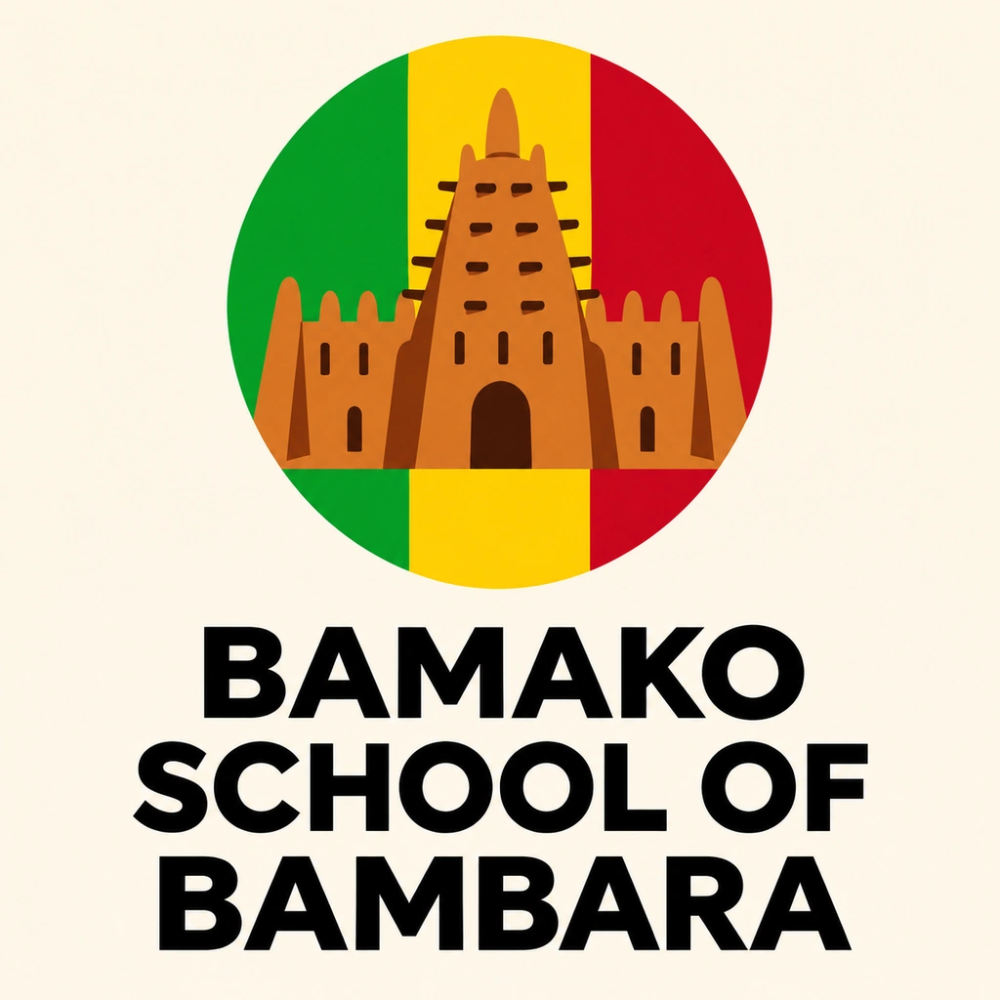
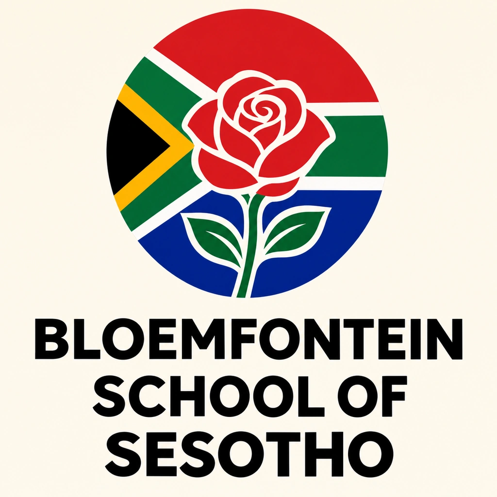
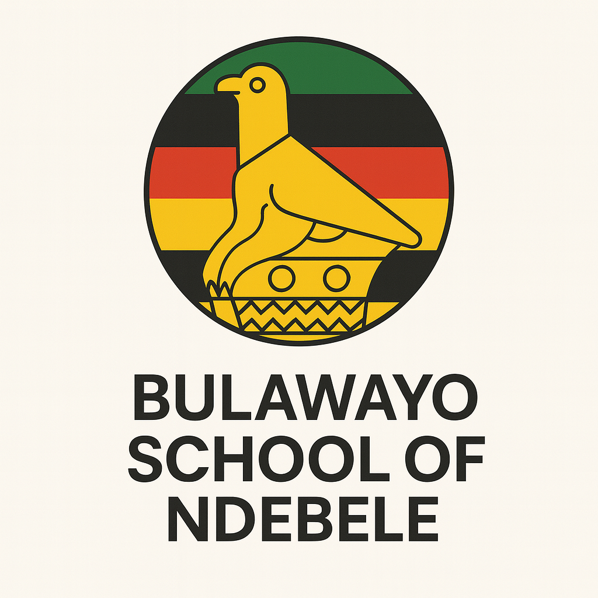
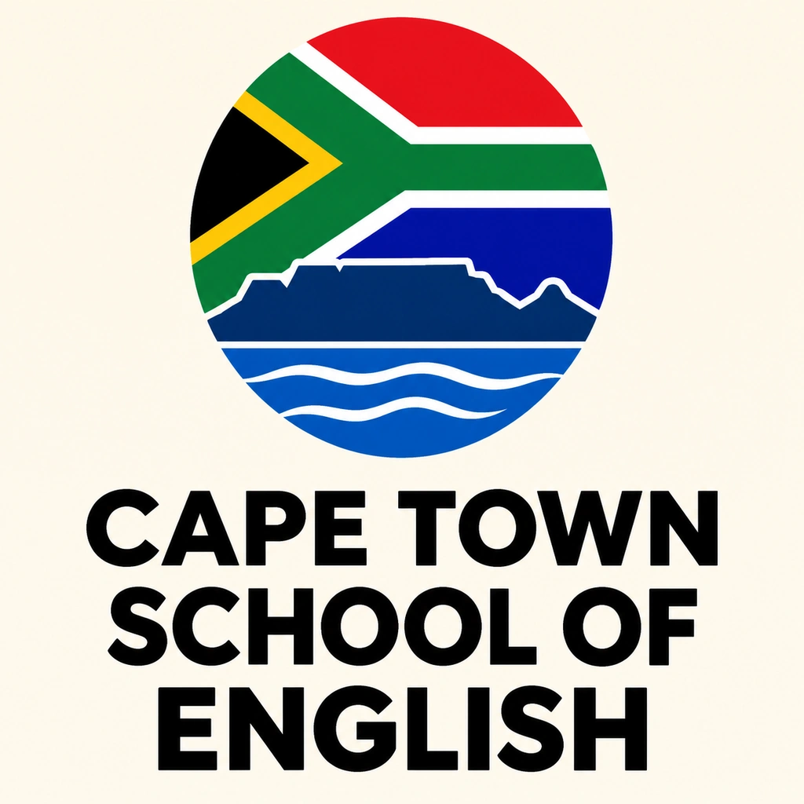
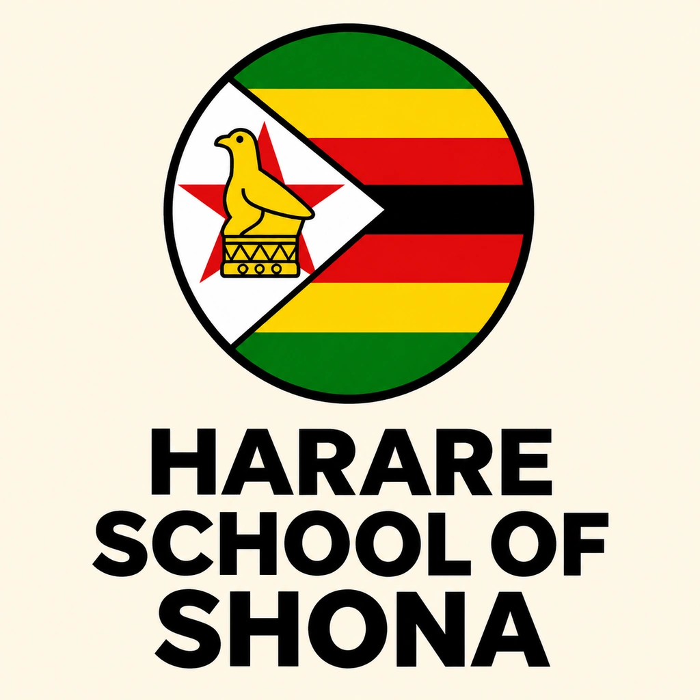
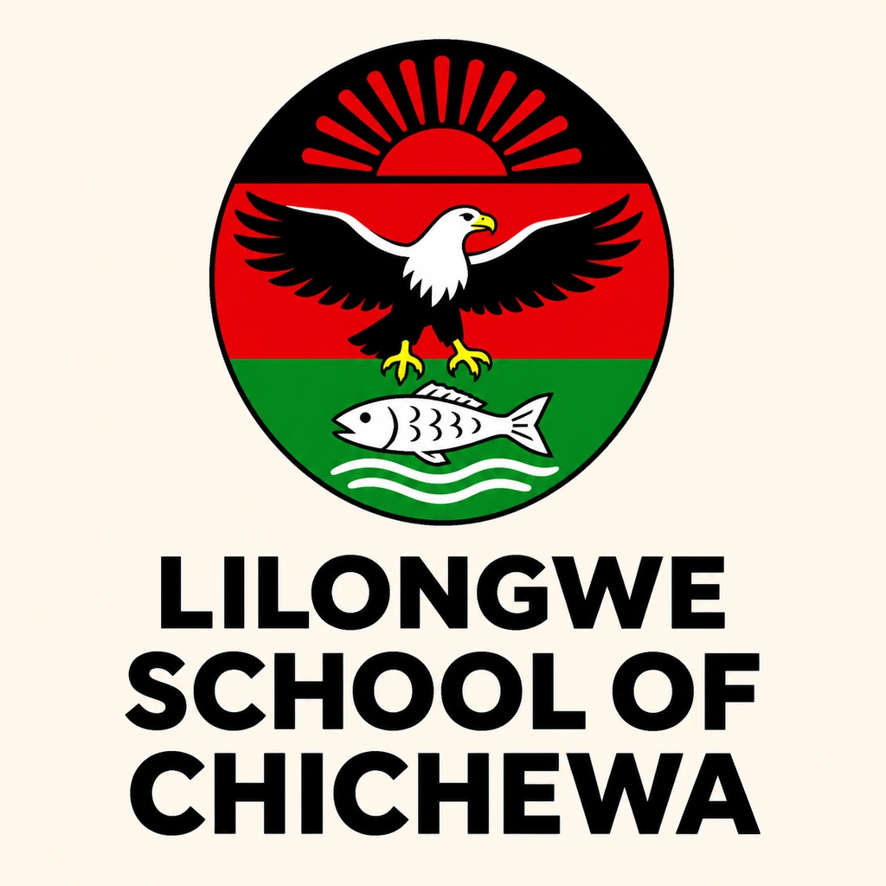

# African School Logos

34 square school logos in WebP format, 1024 × 1024 pixels. Black school names, circular emblems, and national colours.

### ABIDJAN SCHOOL OF FRENCH

`abidjanschoollogo.webp`

### ACCRA SCHOOL OF TWI

`accraschoollogo.webp`

### ADDIS ABABA SCHOOL OF AMHARIC

`addisababaschoollogo.webp`

### BAMAKO SCHOOL OF BAMBARA

`bamakoschoollogo.webp`

### BLOEMFONTEIN SCHOOL OF SESOTHO

`bloemfonteinschoollogo.webp`

### BUJUMBURA SCHOOL OF KIRUNDI

`bujumburaschoollogo.webp`

### BULAWAYO SCHOOL OF ISINDEBELE

`bulawayoschoollogo.webp`

### CAPE TOWN SCHOOL OF ENGLISH

`capetownschoollogo.webp`

### DAKAR SCHOOL OF WOLOF

`dakarschoollogo.webp`

### DURBAN SCHOOL OF ZULU

`durbanschoollogo.webp`

### EAST LONDON SCHOOL OF XHOSA

`eastlondonschoollogo.webp`

### GABORONE SCHOOL OF SETSWANA

`gaboroneschoollogo.webp`

### GQEBERHA SCHOOL OF XHOSA

`gqeberhaschoollogo.webp`

### HARARE SCHOOL OF SHONA

`harareschoollogo.webp`

### IBADAN SCHOOL OF YORUBA

`ibadanschoollogo.webp`

### JOHANNESBURG SCHOOL OF FRENCH

`johannesburgschoollogo.webp`

### KAMPALA SCHOOL OF LUGANDA

`kampalaschoollogo.webp`

### KIGALI SCHOOL OF KINYARWANDA

`kigalischoollogo.webp`

### KINSHASA SCHOOL OF LINGALA

`kinshasaschoollogo.webp`

### LILONGWE SCHOOL OF CHICHEWA

`lilongweschoollogo.webp`

### LUANDA SCHOOL OF PORTUGUESE

`luandaschoollogo.webp`

### LUSAKA SCHOOL OF NYANJA

`lusakaschoollogo.webp`

### MAFIKENG SCHOOL OF SETSWANA

`mafikengschoollogo.webp`

### MALABO SCHOOL OF SPANISH

`malaboschoollogo.webp`

### MANGAUNG SCHOOL OF SESOTHO

`mangaungschoollogo.webp`

### MANZINI SCHOOL OF SISWATI

`manzinischoollogo.webp`

### MAPUTO SCHOOL OF PORTUGUESE

`maputoschoollogo.webp`

### MASERU SCHOOL OF SESOTHO

`maseruschoollogo.webp`

### MBABANE SCHOOL OF SISWATI

`mbabaneschoollogo.webp`

### MBOMBELA SCHOOL OF SISWATI

`mbombelaschoollogo.webp`

### MWANZA SCHOOL OF SWAHILI

`mwanzaschoollogo.webp`

### NAIROBI SCHOOL OF SWAHILI

`nairobischoollogo.webp`

### STELLENBOSCH SCHOOL OF AFRIKAANS

`stellenboschschoollogo.webp`

### YAOUNDÉ SCHOOL OF FRENCH

`yaoundeschoollogo.webp`
