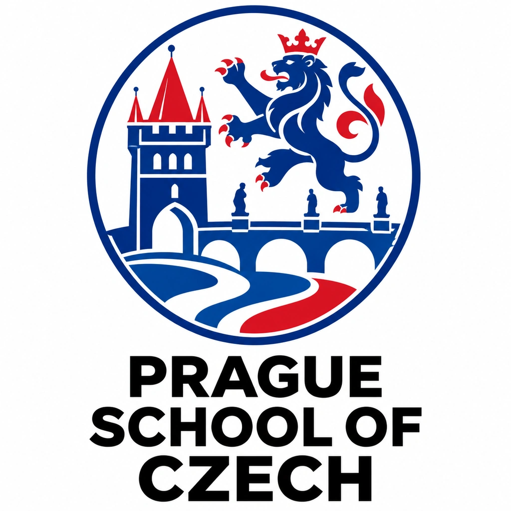
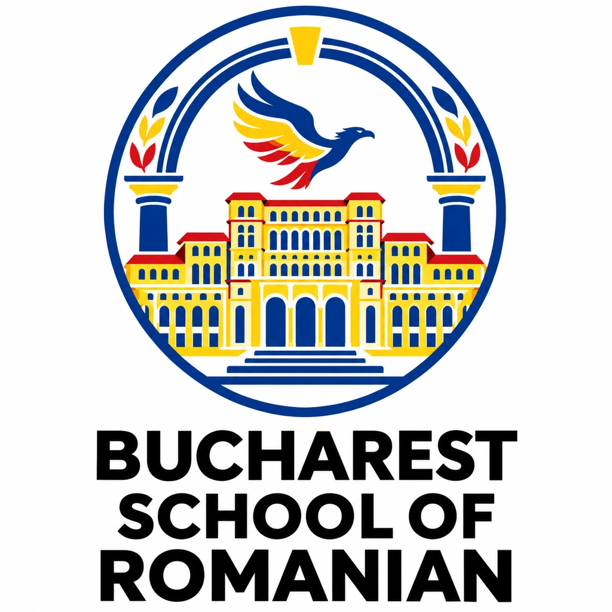
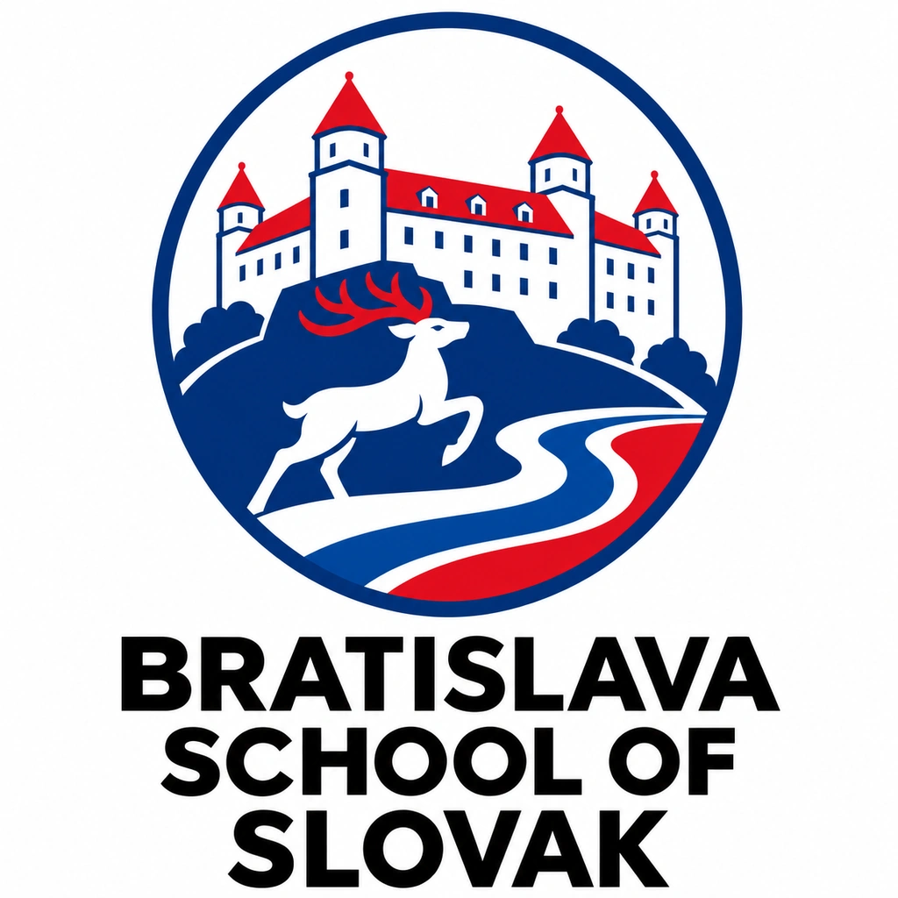

# european School Logos — Batch 01

10 new square 1024 × 1024 WebP logos. White backgrounds, black school names, circular emblems in national colours. Existing files preserved.

## Zagreb School of Croatian

`zagrebschoollogo.webp`

## Prague School of Czech

`pragueschoollogo.webp`

## Geneva School of French

`genevaschoollogo.webp`

## Bern School of German

`bernschoollogo.webp`

## Budapest School of Hungarian

`budapestschoollogo.webp`

## Warsaw School of Polish

`warsawschoollogo.webp`

## Bucharest School of Romanian

`bucharestschoollogo.webp`

## Chur School of Romansh

`churschoollogo.webp`

## Bratislava School of Slovak

`bratislavaschoollogo.webp`

## Ljubljana School of Slovenian

`ljubljanaschoollogo.webp`
