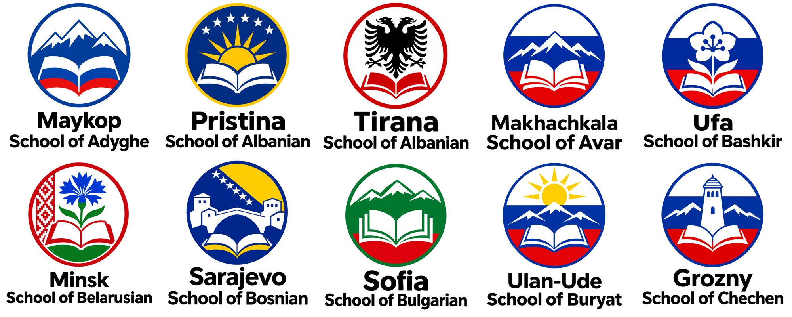

# European school logos — Batch 02

10 missing logos added. Square 1024 × 1024 lossless WebP, pure white backgrounds, circular emblems, black school names. Existing files preserved.

- Maykop School of Adyghe: [maykopschoollogo.webp](maykopschoollogo.webp)
- Pristina School of Albanian: [pristinaschoollogo.webp](pristinaschoollogo.webp)
- Tirana School of Albanian: [tiranaschoollogo.webp](tiranaschoollogo.webp)
- Makhachkala School of Avar: [makhachkalaschoollogo.webp](makhachkalaschoollogo.webp)
- Ufa School of Bashkir: [ufaschoollogo.webp](ufaschoollogo.webp)
- Minsk School of Belarusian: [minskschoollogo.webp](minskschoollogo.webp)
- Sarajevo School of Bosnian: [sarajevoschoollogo.webp](sarajevoschoollogo.webp)
- Sofia School of Bulgarian: [sofiaschoollogo.webp](sofiaschoollogo.webp)
- Ulan-Ude School of Buryat: [ulanudeschoollogo.webp](ulanudeschoollogo.webp)
- Grozny School of Chechen: [groznyschoollogo.webp](groznyschoollogo.webp)
