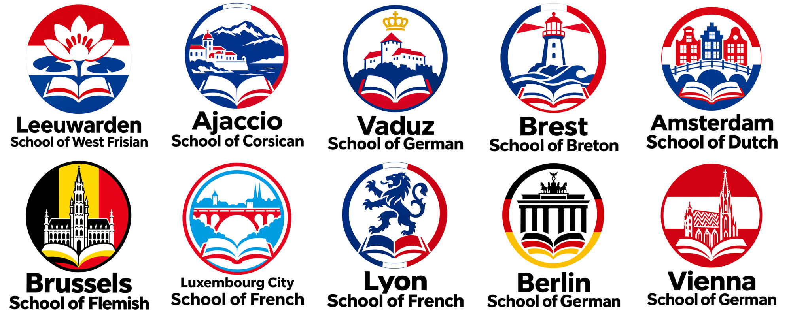

# European school logos — Batch 03: Western Europe

10 missing school logos. Square 1024 × 1024 WebP, pure white backgrounds, circular emblems in national colours and readable black school names. Existing files preserved.

- Leeuwarden School of West Frisian: [leeuwardenschoollogo.webp](leeuwardenschoollogo.webp)
- Ajaccio School of Corsican: [ajaccioschoollogo.webp](ajaccioschoollogo.webp)
- Vaduz School of German: [vaduzschoollogo.webp](vaduzschoollogo.webp)
- Brest School of Breton: [brestschoollogo.webp](brestschoollogo.webp)
- Amsterdam School of Dutch: [amsterdamschoollogo.webp](amsterdamschoollogo.webp)
- Brussels School of Flemish: [brusselsschoollogo.webp](brusselsschoollogo.webp)
- Luxembourg City School of French: [luxembourgcityschoollogo.webp](luxembourgcityschoollogo.webp)
- Lyon School of French: [lyonschoollogo.webp](lyonschoollogo.webp)
- Berlin School of German: [berlinschoollogo.webp](berlinschoollogo.webp)
- Vienna School of German: [viennaschoollogo.webp](viennaschoollogo.webp)
