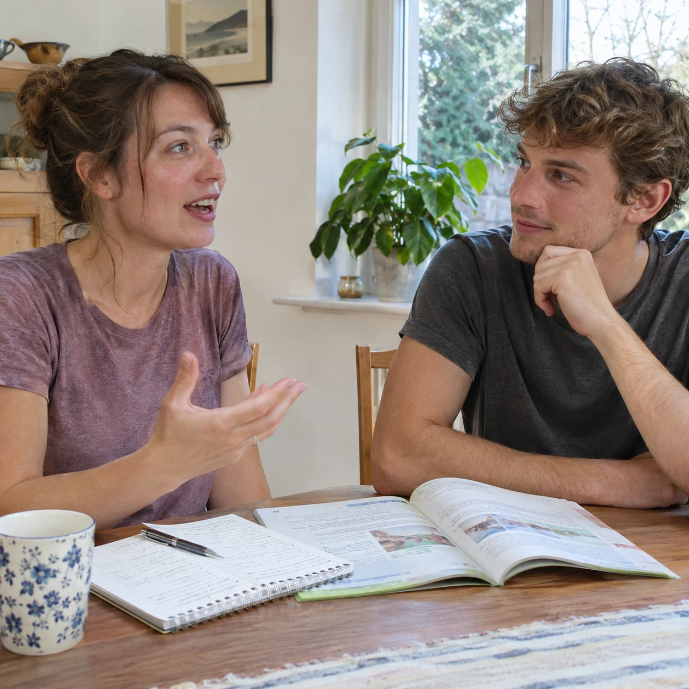
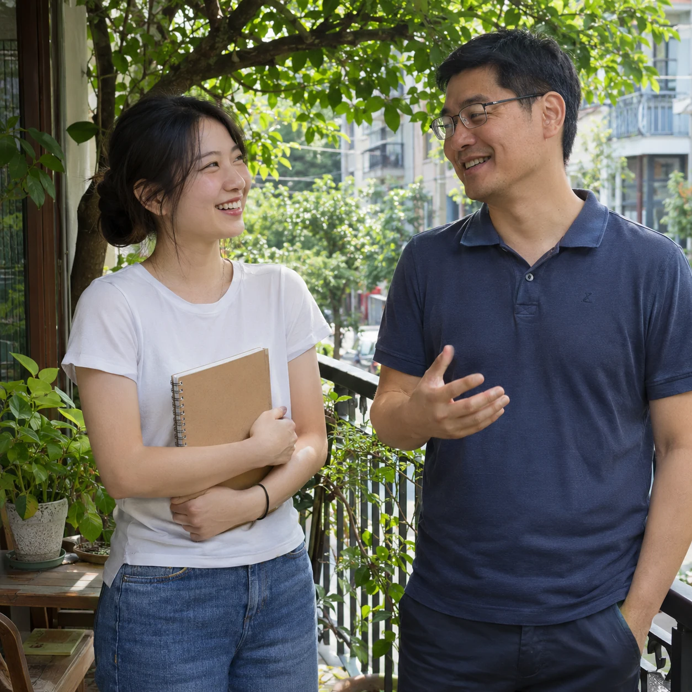
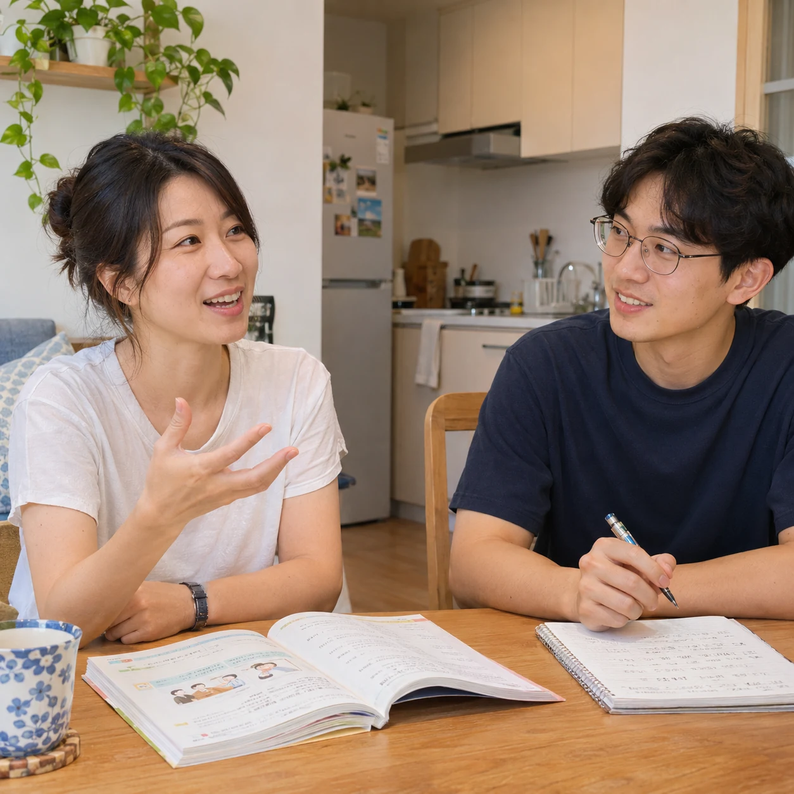
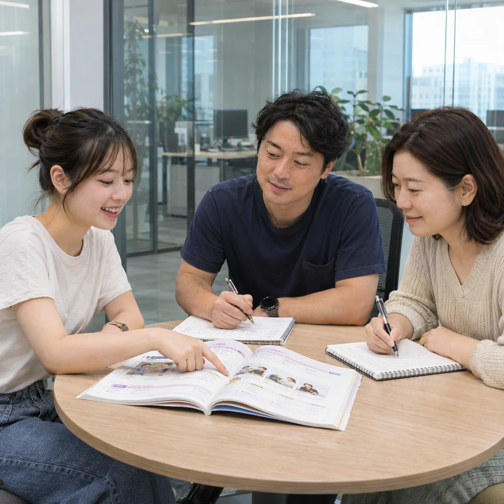
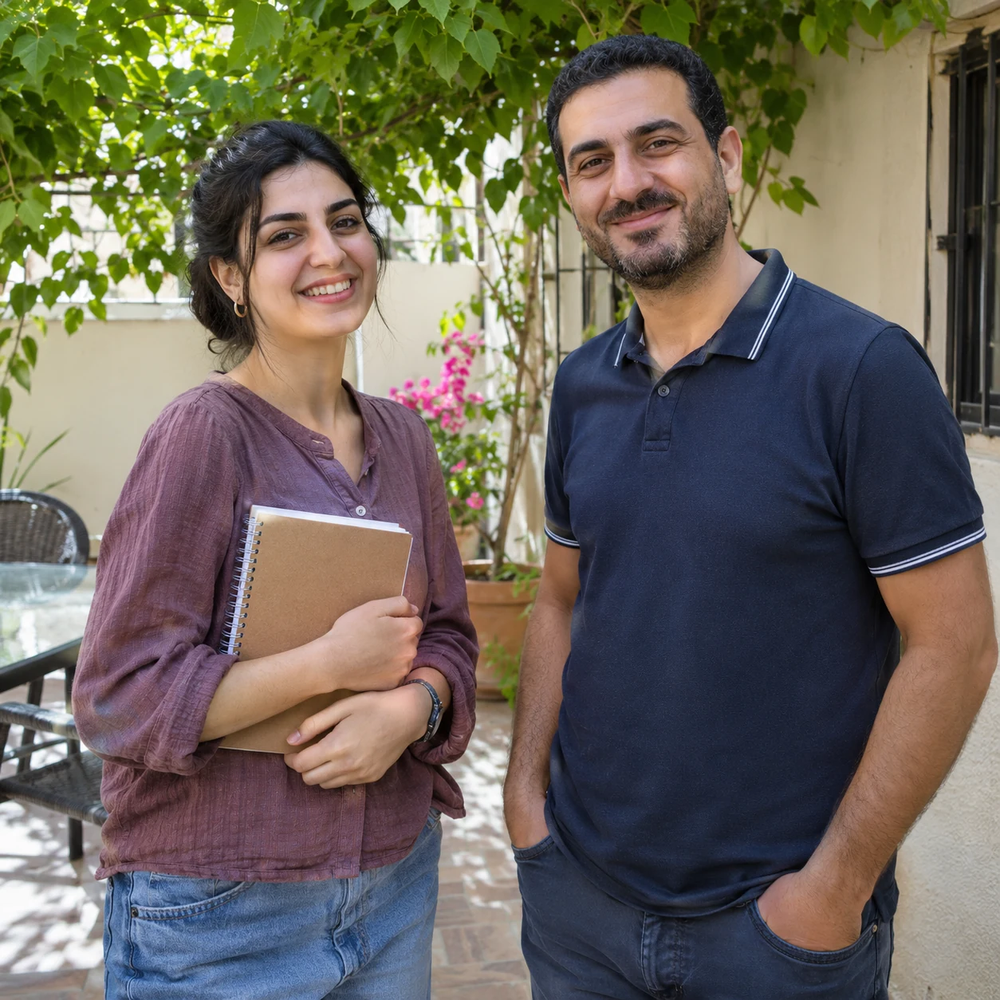
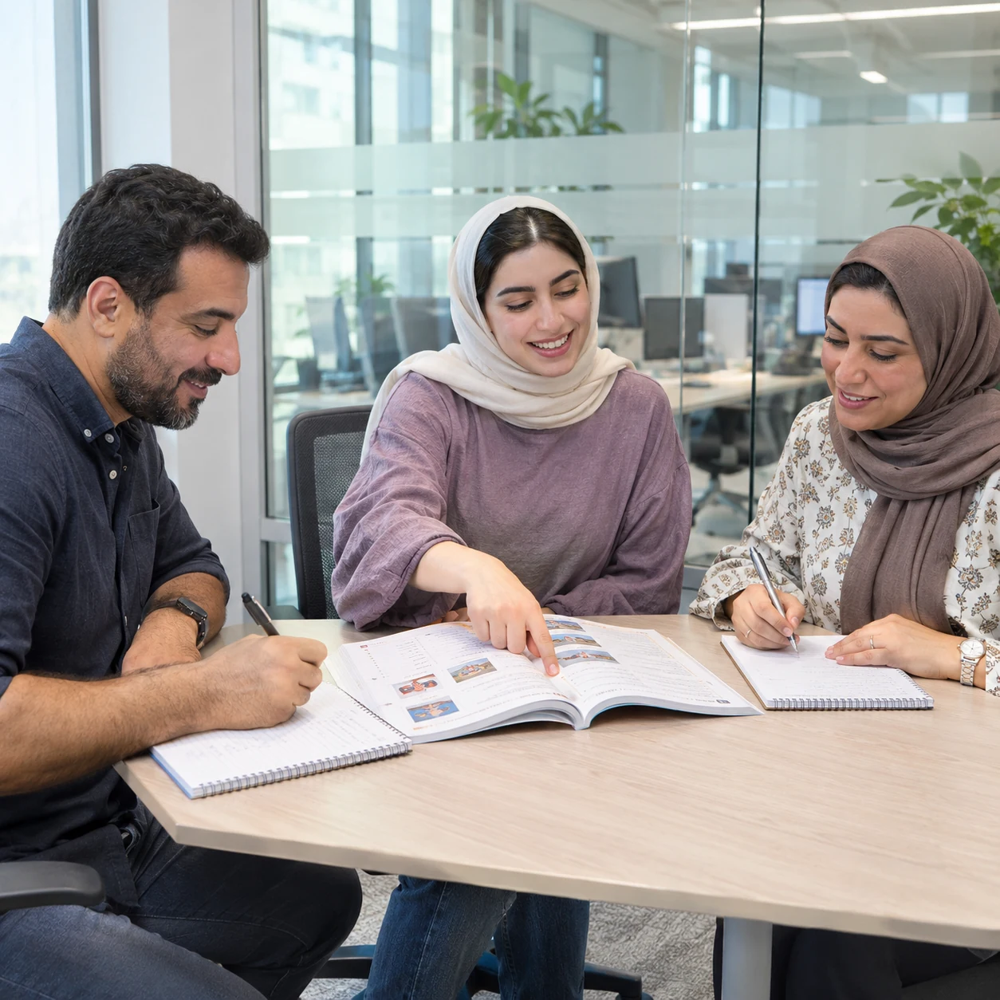
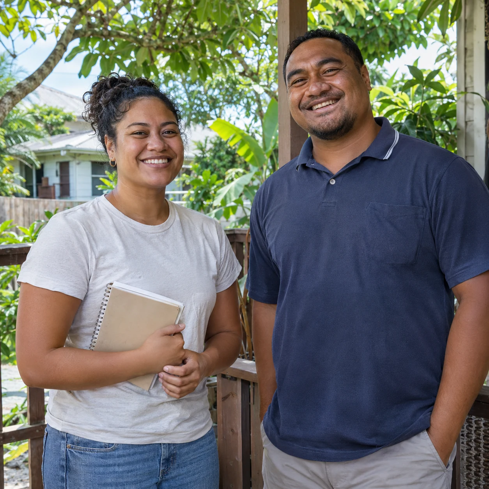
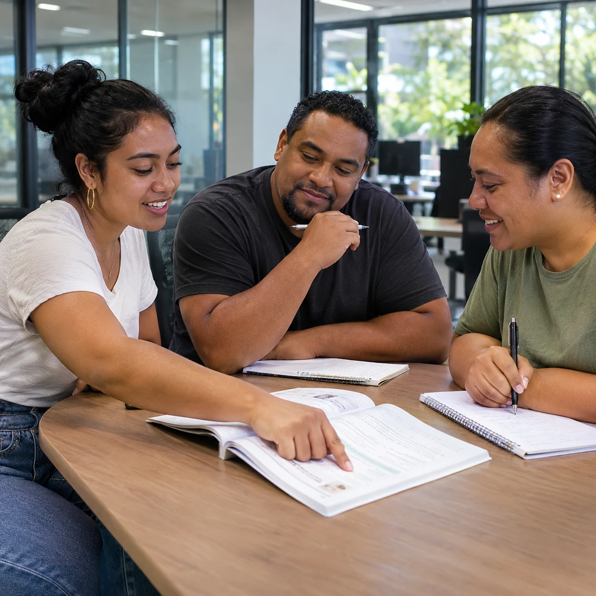

# Regional website media

Square WebP images for Western, Asian, Middle East and Pacific websites. Casual young adult teachers; corporate photos show one teacher and two learners. These are generated illustrations of the service, not photographs of actual staff or students.

Director and speaking-practice video sections use still WebP replacements in this set. A WebP image must be displayed with an image element, not a WebM video source. Existing shared Amasomo and speaking-method assets are not changed.

## Western

| Section | Image | Filename |
|---|---|---|
| Director |  | [`directorwestern.webp`](directorwestern.webp) |
| Private Lesson |  | [`outsideteacherandstudentwestern.webp`](outsideteacherandstudentwestern.webp) |
| Speaking Practice |  | [`inhousewestern.webp`](inhousewestern.webp) |
| Corporate 1 |  | [`corporatewestern1.webp`](corporatewestern1.webp) |
| Corporate 2 |  | [`corporatewestern2.webp`](corporatewestern2.webp) |

## Asian

| Section | Image | Filename |
|---|---|---|
| Director |  | [`directorwestern.webp`](directorwestern.webp) |
| Private Lesson |  | [`outsideteacherandstudentasia.webp`](outsideteacherandstudentasia.webp) |
| Speaking Practice |  | [`inhouseasia.webp`](inhouseasia.webp) |
| Corporate 1 |  | [`corporateasia1.webp`](corporateasia1.webp) |
| Corporate 2 |  | [`corporateasia2.webp`](corporateasia2.webp) |

## Middle East

| Section | Image | Filename |
|---|---|---|
| Director |  | [`directorwestern.webp`](directorwestern.webp) |
| Private Lesson |  | [`outsideteacherandstudentmiddleeast.webp`](outsideteacherandstudentmiddleeast.webp) |
| Speaking Practice |  | [`inhousemiddleeast.webp`](inhousemiddleeast.webp) |
| Corporate 1 |  | [`corporatemiddleeast1.webp`](corporatemiddleeast1.webp) |
| Corporate 2 |  | [`corporatemiddleeast2.webp`](corporatemiddleeast2.webp) |

## Pacific

| Section | Image | Filename |
|---|---|---|
| Director |  | [`directorpacific.webp`](directorpacific.webp) |
| Private Lesson |  | [`outsideteacherandstudentpacific.webp`](outsideteacherandstudentpacific.webp) |
| Speaking Practice |  | [`inhousepacific.webp`](inhousepacific.webp) |
| Corporate 1 |  | [`corporatepacific1.webp`](corporatepacific1.webp) |
| Corporate 2 |  | [`corporatepacific2.webp`](corporatepacific2.webp) |

